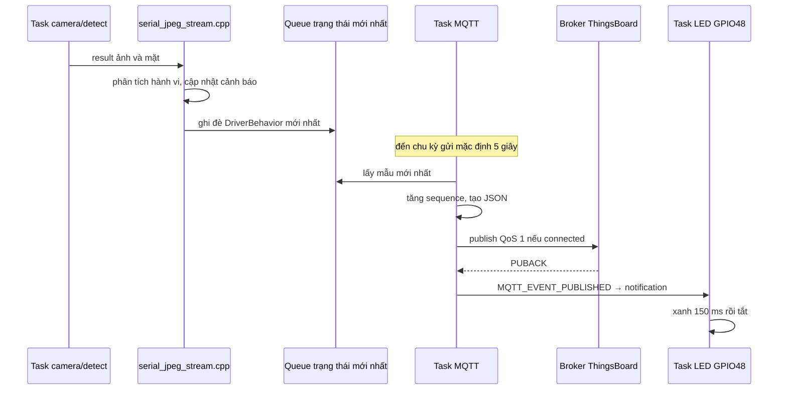

# Giải thích mã nguồn theo từng file

Tài liệu này dành cho người đã tải repo và muốn hiểu **mỗi file làm gì,
ai gọi nó, dữ liệu đi qua nó thế nào và chạy lệnh liên quan sẽ tạo ra gì**.
Các tên hàm và giá trị dưới đây được đối chiếu với mã nguồn trong repo.
Hướng dẫn cài đặt, build và nạp nằm ở [README](../README.md); phần tổng quan
và ví dụ các chỉ số nằm ở [Hệ thống hoạt động](HE_THONG_HOAT_DONG.md).

Đọc lần đầu theo thứ tự sau:

1. [File nào chạy trên bo, file nào chạy trên PC?](#cach-doc)
2. [Các file firmware trong `main/`](#firmware)
3. [Các chương trình Python trên PC](#python)
4. [Các file cấu hình và quá trình build](#cau-hinh)
5. [Các file thư viện ESP-WHO bên dưới ứng dụng](#thu-vien)
6. [Theo dấu một blink, một lần ngáp và một bản tin MQTT](#theo-dau)
7. [Muốn thay đổi hoặc tìm lỗi thì mở file nào?](#tim-loi)

<a id="cach-doc"></a>

## 1. Trước hết: không phải file nào cũng mở lên rồi bấm Run

**Firmware** là chương trình được nạp vào bộ nhớ flash của ESP32-S3. Các
file C++ trong `main/` cùng một phần thư viện được trình biên dịch ghép
thành firmware. Bạn chạy `idf.py build` rồi `idf.py -p COM4 flash`; sau đó
ESP-IDF gọi `app_main()` khi bo khởi động. Không chạy riêng
`driver_behavior.cpp` bằng một lệnh Python hoặc bằng nút Run trên PC.

**Script Python** là chương trình chạy trên PC. Ví dụ chạy
`driver_monitor_viewer.py` thì PC mở cổng COM để nhận ảnh từ bo. Đóng script
chỉ đóng cửa sổ PC; firmware vẫn đang chạy nếu bo còn nguồn.

**File cấu hình** được công cụ đọc để chọn phần cứng, thư viện, ngưỡng và
cách build. Mở `sdkconfig` hoặc `CMakeLists.txt` không làm camera hoạt động.
Các thay đổi ảnh hưởng firmware phải được build và flash mới có hiệu lực
trên bo. Riêng đổi `--port COM7` của viewer chỉ thay cổng mà PC mở.

| Loại file | Ý nghĩa với người mới |
| --- | --- |
| `.cpp` | Mã thực hiện công việc: đọc ảnh, tính toán, điều khiển chân, gửi dữ liệu. |
| `.hpp` | Khai báo tên hàm, lớp và cấu trúc để các file C++ dùng chung; riêng `driver_ml_weights.hpp` còn chứa các số đã học. |
| `.py` | Chương trình hoặc phần mở rộng công cụ chạy trên PC. Chỉ các script có giao diện dòng lệnh mới được chạy trực tiếp theo hướng dẫn. |
| `CMakeLists.txt` | Danh sách và quan hệ các phần cần biên dịch. |
| `Kconfig.projbuild`, `Kconfig` | Định nghĩa các lựa chọn để hiện trong menu cấu hình. |
| `idf_component.yml` | Khai báo thư viện cần tải và điều kiện phiên bản. |
| `sdkconfig.bsp.*` | Cấu hình mặc định để tạo dự án cho một bo cụ thể. |
| `.json`, `.jsonl` | Dữ liệu có cấu trúc. JSONL chứa một đối tượng JSON trên mỗi dòng, thuận tiện ghi liên tục từng khung hình. |
| `.csv` phân vùng | Sơ đồ chia flash cho chương trình và dữ liệu. |

Một số từ được dùng xuyên suốt:

| Từ | Giải thích trong dự án này |
| --- | --- |
| Frame / khung hình | Một ảnh chụp tại một thời điểm. Video là nhiều ảnh liên tiếp. |
| Buffer / bộ đệm | Vùng RAM tạm giữ ảnh hoặc dữ liệu trước khi phần tiếp theo xử lý. |
| Task | Công việc được FreeRTOS lập lịch, ví dụ lấy ảnh, nhận diện, phát âm buzzer. Các task cùng dùng CPU; tạo task không có nghĩa có thêm CPU mới. |
| Callback | Hàm đã đăng ký để được gọi khi có kết quả hoặc sự kiện. Ví dụ có kết quả tìm mặt thì gọi hàm phân tích và gửi stream. |
| Landmark / điểm mốc | Tọa độ mắt, mũi và khóe miệng để biết cần đo vùng ảnh nào. |
| Feature / đặc trưng | Các con số lấy từ ảnh để đưa vào model, ở đây chủ yếu là 144 giá trị sáng đã chuẩn hóa. |
| Weight / trọng số | Hệ số đã được quá trình train điều chỉnh; firmware dùng chúng để tính điểm trên ảnh mới. |
| Inference / suy luận | Dùng trọng số có sẵn để dự đoán; diễn ra trên ESP32-S3 mỗi lần xử lý ảnh. |
| Training / huấn luyện | Dùng ảnh có nhãn để tìm trọng số; chỉ chạy trên PC khi bạn chủ động chạy script train. |
| ACK | Xác nhận của broker cho bản tin MQTT QoS 1. Nó xác nhận trao đổi MQTT, không xác nhận model nhận diện đúng. |

<a id="firmware"></a>

## 2. Các file firmware trong `examples/ov3660_face_detect/main/`

### 2.1. `app_main.cpp`: khởi động và nối các phần lại với nhau

Mở [app_main.cpp](../examples/ov3660_face_detect/main/app_main.cpp).
Đây là điểm bắt đầu của ứng dụng trên bo. Nó không chứa toàn bộ thuật toán
mắt/miệng; nhiệm vụ của nó là tạo và khởi chạy những đối tượng làm công việc đó.

Khi cấp nguồn hoặc nhấn RST, trình tự chính là:

1. `app_main()` nâng mức ưu tiên task khởi động lên 5.
2. Gọi `serial_jpeg_stream_init()`. Hàm này khởi tạo UART và gọi phần buzzer,
   vì vậy tiếng bíp khởi động xuất phát gián tiếp từ bước này.
3. Với cấu hình OV3660 và BSP ESP32-S3-EYE, gọi
   `driver_status_led_start()` để chuẩn bị LED GPIO48 và xóa màu đang giữ.
4. Gọi `driver_telemetry_start()` để chuẩn bị Wi-Fi/MQTT. Nếu chưa điền cấu
   hình thì phần này trả về; ứng dụng tiếp tục khởi động camera.
5. Với bo hiện tại, gọi `run_detect_term()`. Tên `term` được kế thừa từ ví
   dụ ESP-WHO; ứng dụng đã thay callback in chữ bằng callback gửi stream.

`run_detect_term()` tạo pipeline lấy ảnh, tạo `WhoDetectAppSerial`, gắn
model do `get_detect_model()` trả về, rồi gọi `run()`. Khi
`DETECT_MODEL=human_face_detect`, `get_detect_model()` tạo `HumanFaceDetect`.
Đây là **model tìm mặt và điểm mốc của Espressif**, khác với model mắt/miệng
nhỏ trong `driver_ml_weights.hpp`.

Lớp `WhoDetectAppSerial` là phần nối quan trọng. Constructor đăng ký:

```cpp
m_detect->set_detect_result_cb([](const who::detect::WhoDetect::result_t &result) {
    serial_jpeg_stream_send(result);
});
```

Nghĩa là: **mỗi khi task tìm mặt có kết quả, gọi
`serial_jpeg_stream_send(result)` ngay trong task đó**. Chưa có viewer trên
PC thì callback vẫn được gọi; việc mở viewer không khởi động model trên bo.

`WhoDetectAppSerial::run()` khởi chạy task lấy ảnh trên core 0, stack 4096,
và task nhận diện trên core 1, stack 8192. Stack là RAM dành cho lời gọi hàm
và biến cục bộ của task. Task nhận diện cần stack lớn hơn bản ESP-WHO gốc
vì callback hiện làm cả phân tích hành vi, định dạng JSON và nén JPEG.

File còn có `run_detect_lcd()` và nhánh ESP32-P4 để giữ cấu trúc ví dụ gốc.
Với cấu hình OV3660/S3 hiện tại, luồng chạy chính là `run_detect_term()`.
Muốn hiểu vì sao một hàm được gọi lúc khởi động thì xem file này trước;
muốn đổi cách tính blink thì chuyển sang `driver_behavior.cpp`.

### 2.2. `frame_cap_pipeline.cpp` và `.hpp`: tạo nguồn ảnh thật từ camera

Mở [file thực hiện](../examples/ov3660_face_detect/main/frame_cap_pipeline.cpp)
và [file khai báo](../examples/ov3660_face_detect/main/frame_cap_pipeline.hpp).
Header công bố `get_dvp_frame_cap_pipeline(bool lcd)` để `app_main.cpp`
gọi được. Hàm trả về một `WhoFrameCap*`, tức đối tượng quản lý các bước lấy ảnh.

Với OV3660, `start_ov3660_camera()` thực hiện các việc sau:

1. `bsp_i2c_init()` chuẩn bị đường điều khiển camera. Camera cần nhận lệnh
   cấu hình bên cạnh đường dữ liệu ảnh; BSP cung cấp chân tương ứng của bo.
2. Tạo XCLK **20 MHz** bằng LEDC, rồi chờ 100 ms. XCLK là xung cho cảm biến
   hoạt động; 20 MHz không có nghĩa video gửi tới PC đạt 20 FPS.
3. Lấy 8 chân dữ liệu D0–D7, VSYNC, HSync/HREF và PCLK từ BSP để cấu hình DVP.
   DVP là giao tiếp song song chở dữ liệu ảnh từ OV3660 vào ESP32-S3.
4. Dùng I2C đã khởi tạo và gọi `esp_video_init()` để đưa camera vào hoạt động.
   Driver DVP được yêu cầu không tự điều khiển XCLK lần nữa, tránh tranh chân
   đang được LEDC tạo xung.

Sau đó `get_dvp_frame_cap_pipeline(false)` tạo `VideoCapture`, chọn
`V4L2_PIX_FMT_RGB565X`, đặt lật trái–phải và chiều dọc rồi bắt đầu capture.
RGB565 lưu một pixel bằng 16 bit: đỏ 5 bit, xanh lá 6 bit, xanh dương 5 bit.
Một ảnh 240 × 240 vì vậy chiếm `240 × 240 × 2 = 115200` byte trước khi nén.

Kích thước **240 × 240** và chế độ cảm biến danh định **24 FPS** được chọn
trong `sdkconfig.bsp.esp32_s3_eye_noglib`, sau đó driver sử dụng cấu hình đó.
Không có lệnh `resize(240, 240)` của OpenCV trên PC để tạo ảnh cho nhận diện.
FPS hiển thị cuối cùng còn phụ thuộc nhận diện, nén JPEG và tốc độ UART.

Với model mặt, `MODEL_TIME=2`; khi `lcd=false`, số buffer camera là
`MODEL_TIME + 2 = 4`. Pipeline thêm một `WhoFetchNode` để lấy ảnh và báo
cho task nhận diện khi có ảnh sẵn sàng. Bộ đệm giúp các bước làm việc lệch
nhau một chút về thời gian, nhưng không làm khâu xử lý chậm chạy nhanh hơn.

**Ý nghĩa khi sửa file:** đổi lật gương ở đây sẽ đổi ảnh mà cả model lẫn
viewer nhìn thấy. Đổi định dạng/kích thước cần kiểm tra đồng thời driver
cảm biến, model và điều kiện 240 × 240 trong `serial_jpeg_stream.cpp`.
Chỉ đổi kích thước cửa sổ viewer không đổi ảnh gốc trên bo.

### 2.3. `serial_jpeg_stream.cpp` và `.hpp`: điều phối một kết quả và đóng gói stream

Mở [file thực hiện](../examples/ov3660_face_detect/main/serial_jpeg_stream.cpp)
và [file khai báo](../examples/ov3660_face_detect/main/serial_jpeg_stream.hpp).
Header công bố hai hàm `serial_jpeg_stream_init()` và
`serial_jpeg_stream_send(result)`. Comment còn nhắc `testiot.py` từ bản
thử cũ; trình xem dùng trong repo này là `driver_monitor_viewer.py`.

`serial_jpeg_stream_init()` tắt log ứng dụng sau thời điểm chuyển chế độ,
chuẩn bị UART0 ở **921600 baud**, rồi gọi `alert.init()`. Tắt log giúp hạn
chế chữ log trộn vào luồng nhị phân. Dòng chữ khởi động xuất hiện trước đó
được trình đọc trên PC bỏ qua khi tìm dấu bắt đầu gói.

Ở cấp file có hai đối tượng được giữ suốt lần chạy:

```cpp
DriverBehaviorAnalyzer analyzer;
DriverAlert alert;
```

Chúng nhớ trạng thái qua nhiều ảnh. Nếu tạo mới chúng ở mỗi khung, bộ đếm
và thời điểm bắt đầu nhắm mắt sẽ mất trước khi đủ thời gian để xét sự kiện.

Mỗi callback gọi `serial_jpeg_stream_send(result)` theo thứ tự thực tế:

```text
1. analyzer.update(result)          -> đo mắt/miệng, đếm sự kiện, tính PERCLOS
2. alert.update(behavior)           -> thêm lý do báo và chọn nhịp buzzer
3. nếu alert trả true              -> analyzer.reset_perclos()
4. driver_telemetry_update(behavior)-> chuyển trạng thái mới nhất cho MQTT
5. kiểm tra ảnh RGB565BE 240 × 240
6. chép ảnh sang vùng PSRAM riêng, vẽ khung mặt trên bản chép
7. nén bản chép thành JPEG, tạo JSON trạng thái
8. gửi gói JSON, sau đó gói JPEG qua UART
```

Vì bước 1–4 đứng trước kiểm tra/nén ảnh, có thể vẫn cập nhật hành vi và
MQTT dù một ảnh không được gửi thành công lên viewer. Ngược lại, callback
chạy đồng bộ trong task nhận diện: nén ảnh hoặc ghi UART lâu sẽ làm task
nhận diện chậm chuyển sang lượt tiếp theo. Có hai core không loại bỏ
được mọi điểm chờ trong một task.

Bản ảnh riêng tránh dùng tiếp buffer camera đang có thể được tái sử dụng
trong lúc nén. Khung mặt phát hiện được vẽ đỏ; khung được giữ tạm khi
`face_holdover` được vẽ vàng. Thuật toán hành vi đã chạy **trước khi vẽ**,
nên các nét này không được đưa vào model mắt/miệng ở lượt hiện tại.

`fmt2jpg(..., 55, ...)` tạo ảnh JPEG chất lượng 55. Ảnh lớn hơn 100000
byte hoặc nén lỗi bị bỏ. Sau khi gửi, vùng nhớ ảnh/JPEG được giải phóng;
đây là bộ nhớ tạm, không phải album ảnh được lưu trong flash của bo.

`write_packet()` tạo giao thức để PC tìm lại ranh giới gói:

| Phần | Kích thước | Ý nghĩa |
| --- | --- | --- |
| `AA 55 AA` | 3 byte | Dấu bắt đầu để PC tìm gói giữa dòng byte. |
| Loại gói | 1 byte | `0x56` là JSON trạng thái; `0x55` là JPEG. |
| Độ dài payload | 4 byte little-endian | PC biết cần chờ bao nhiêu byte nội dung. |
| Payload | Theo độ dài | JSON hoặc ảnh JPEG. |
| Checksum | 4 byte little-endian | FNV-1a 32 bit trên loại gói, độ dài và payload; dùng phát hiện gói bị thay đổi/mất byte. |

Checksum chỉ kiểm tra tính toàn vẹn gói; không yêu cầu bo gửi lại gói hỏng.
Viewer bỏ gói hỏng rồi tìm gói tiếp theo. Tốc độ 921600 baud ở serial 8N1
cho trần lý thuyết khoảng 92160 byte/giây, trước các thời gian xử lý khác.
JPEG càng lớn thì càng mất thời gian truyền và FPS càng dễ giảm.

### 2.4. `driver_behavior.hpp`: dữ liệu kết quả và bộ nhớ qua thời gian

Mở [driver_behavior.hpp](../examples/ov3660_face_detect/main/driver_behavior.hpp).
`struct DriverBehavior` là bản kết quả chung mà phần cảnh báo, MQTT và
stream cùng đọc. Nó chứa các nhóm:

| Nhóm | Ví dụ | Mục đích |
| --- | --- | --- |
| Khả năng quan sát | `driver_present`, `eyes_valid`, `mouth_valid`, `face_holdover` | Cho biết kết luận hiện tại có dữ liệu để dựa vào hay không. |
| Trạng thái và điểm model | `eyes_closed`, `mouth_open`, hai probability | Phân biệt điểm liên tục với kết luận đã lọc. |
| Sự kiện theo thời gian | `blink_count`, `yawn_count`, `eye_closed_duration_s` | Một ảnh tĩnh không tự cho biết đã xảy ra mấy lần. |
| PERCLOS | `perclos`, `perclos_valid`, `perclos_window_ready`, `perclos_observed_s` | Tỷ lệ nhắm và lượng quan sát dùng để tính. |
| Chẩn đoán ảnh | Độ sáng, độ tương phản, phần vùng tối | Giúp điều tra ánh sáng hoặc vùng lấy mẫu sai. |
| Hình học | `face_box`, `face_keypoints` | Vị trí mặt và 5 điểm mốc. |
| Cảnh báo | `alert_reasons`, `buzzer_pattern`, các window count | Được phần `DriverAlert` bổ sung sau bước phân tích. |

`class DriverBehaviorAnalyzer` có `update()` và `reset_perclos()`. Các biến
`m_...` riêng bên trong giữ lần quan sát trước, thời điểm mắt bắt đầu nhắm,
trạng thái miệng, tổng sự kiện và 60 ô PERCLOS. Phân biệt **kết quả một
khung** (`DriverBehavior`) với **bộ nhớ của bộ phân tích** (`m_...`) giúp
hiểu tại sao reset một cửa sổ có thể giữ nguyên tổng đếm.

### 2.5. `driver_behavior.cpp`: từ pixel đến mắt/miệng, blink, ngáp và PERCLOS

Mở [driver_behavior.cpp](../examples/ov3660_face_detect/main/driver_behavior.cpp).
Đầu vào `update(result)` có ảnh RGB565BE và danh sách mặt từ ESP-WHO; đầu
ra là một `DriverBehavior`. File không mở camera, không tự kết nối Wi-Fi
và không gọi OpenCV. Nó làm phép tính trên ảnh đã được pipeline cung cấp.

**Bước A — chuyển màu thành độ sáng.** `gray_at()` giải mã hai byte RGB565
thành R, G, B rồi tính gần đúng `0.299R + 0.586G + 0.113B`. Như vậy model
mắt/miệng chủ yếu dùng cấu trúc sáng/tối. `gray_sample()` lấy điểm gần nhất
và chặn tọa độ vào biên ảnh. `region_luma()` lấy 8 × 8 điểm để ước lượng
độ sáng vùng ảnh/mặt; nó không đo ánh sáng vật lý bằng lux.

**Bước B — xác định nơi cần đo.** Nếu có nhiều mặt, chọn mặt có score cao
nhất. Box là `[x1, y1, x2, y2]`. Mảng 10 số điểm mốc được dùng theo thứ tự
`mắt 1, khóe miệng 1, mũi, mắt 2, khóe miệng 2`, mỗi điểm gồm x và y.
Đây là thứ tự truy cập trong code, không nên tự giả định mảng có thứ tự
`hai mắt, mũi, hai miệng` khi sửa chương trình.

Mặt cần ít nhất 68 × 75 pixel và đủ điểm mốc để đo. Khi detector bỏ sót,
có thể dùng lại box/điểm mốc gần nhất trong tối đa 1,2 giây. Khoảng giữ này
giúp phần miệng theo dõi một lần há rộng khi đầu ít di chuyển; phần mắt
chủ động ngừng suy luận từ tọa độ cũ vì chúng có thể đã trượt khỏi mắt.
`driver_present=true` vì thế có thể đi cùng `face_holdover=true` và
`eyes_valid=false`.

**Bước C — kiểm tra mắt còn nhìn thấy đủ không.** Tỷ lệ lệch mũi được tính:

```text
eye_gap = x_mắt_2 - x_mắt_1
pose = abs(x_mũi - (x_mắt_1 + x_mắt_2)/2) / eye_gap
```

Ví dụ hai mắt cách 50 pixel, mũi lệch khỏi trung điểm 10 pixel thì
`pose=0.20`, vượt 0.18: mắt không hợp lệ. Đây là chỉ số hình học để lọc
góc khó, không phải số đo góc đầu theo độ. Điều kiện còn yêu cầu không
dùng mặt giữ tạm, điểm mốc nằm trong ảnh và vùng da quanh cả hai mắt có
độ sáng tối thiểu 25. Hệ thống tránh biến vùng mắt bị che/tối thành nhắm mắt.

**Bước D — tạo đặc trưng và tính điểm mắt.** `eye_closed_probability()`
thực hiện lần lượt cho từng mắt:

1. Dùng `grid_mean()` lấy trung bình lưới 3 × 3 ở vùng da phía dưới mắt.
2. Lấy lưới 12 × 12 quanh mắt, thành vector 144 số. Vùng lấy mẫu co giãn
   theo rộng/cao mặt, giúp người đứng gần hoặc xa vẫn có vector cùng độ dài.
3. Chia độ sáng từng điểm cho độ sáng da, giới hạn vào `[0, 2]`. Ví dụ
   điểm mắt 40 và da 100 cho 0.4; khi cả hai cùng sáng gấp đôi thì tỷ lệ
   vẫn là 0.4. Cách này giảm một phần ảnh hưởng đổi phòng.
4. Chuẩn hóa bằng tham số học được: `z[i]=(value[i]-eye_mean[i])*eye_inv_scale[i]`.
5. Tính 24 nút ẩn bằng tổng có trọng số và bias, áp dụng ReLU
   `max(0, giá_trị)`, rồi tính đầu ra và sigmoid `1/(1+exp(-x))`.
6. Lấy trung bình điểm của hai mắt thành `eye_closed_probability`.

Điểm này gần 1 khi model nghiêng về nhắm, gần 0 khi nghiêng về mở. Nó là
ước lượng của model; không được xem `0.90` là bảo đảm đúng 90% ngoài thực tế.

**Bước E — đổi điểm mắt thành trạng thái ổn định.** Mặt gần chính diện
(`pose≤0.10`) có điểm ≥0.80 thì được nhận nhắm ngay ở một khung; mức ≥0.50
cần hai khung liên tiếp. Với `0.10<pose≤0.18`, cần hai khung ≥0.65. Để mở
lại cần hai khung dưới 0.50. Nếu chưa đủ điều kiện đổi, giữ trạng thái hợp
lệ trước đó. Hai khung có thể dài ngắn khác nhau tùy FPS; đây là lọc theo
số khung, chưa phải bộ lọc với thời gian cố định.

**Bước F — đo miệng.** `mouth_open_probability()` lấy tâm giữa hai khóe
miệng, tham chiếu độ sáng hai má, lấy 12 × 12 điểm quanh miệng rồi chuẩn
hóa. Model miệng tính tổng `bias + Σ(z[i]*mouth_w[i])` và đưa qua sigmoid.
Hai khung có điểm ≥0.50 làm miệng mở; hai khung dưới 0.50 làm miệng đóng.
Phần này không dùng 24 nút ẩn như model mắt.

Các hàm `dark_vertical_run()`, `dark_fraction()` và `patch_contrast()` còn
tính độ dài vùng tối, tỷ lệ pixel tối và tương phản. Chúng xuất số chẩn
đoán như `left_eye_aperture`, `mouth_contrast`; kết luận mở/nhắm hiện lấy
từ model và bộ lọc ở trên. Không nên giải thích các trường này thành EAR
hoặc MAR chuẩn: code không có bộ landmark dày đo viền mí/môi theo cách đó.

**Bước G — từ trạng thái thành sự kiện.**

| Sự kiện | Bộ nhớ và điều kiện trong file |
| --- | --- |
| Blink | Ghi `m_eye_closed_since_us` khi bắt đầu nhắm. Khi mở lại, nếu nhắm từ 80000 đến 1200000 µs thì cộng một blink. Nhắm 2 giây không nằm trong khoảng blink này. |
| Ngáp | Ghi `m_mouth_open_since_us`; sau 800000 µs mở miệng thì cộng một lần và đặt `m_yawn_counted=true`. Đóng miệng đủ 1000000 µs mới gỡ cờ để lần há tiếp có thể được đếm. |
| Mất mắt | Khi đầu quá nghiêng, bỏ trạng thái nhắm cũ ngay. Các mất đo khác có khoảng giữ ngắn; quá 500000 µs thì xóa thời điểm/trạng thái mắt cũ. |
| Mất miệng | Quá 500000 µs không có miệng hợp lệ thì xóa các thời điểm và trạng thái chuyển tiếp. Cờ chống đếm lại ngáp vẫn cần một đoạn miệng đóng hợp lệ để được gỡ. |

1 giây bằng 1000000 µs. Các thời điểm lấy từ `esp_timer_get_time()` trên
bo, nên thao tác đóng viewer không xóa bộ đếm. Tổng blink/ngáp nằm trong
RAM và về 0 khi bo khởi động lại.

**Bước H — tích lũy PERCLOS.** `m_perclos[60]` là 60 ô theo giây, mỗi ô
ghi thời gian quan sát và thời gian nhắm. Ô có nhãn giây để phân biệt dữ
liệu mới với dữ liệu từ vòng cũ. Sau mỗi ảnh mắt hợp lệ, nếu lần đo trước
đủ gần thì cộng khoảng thời gian giữa hai lần; trạng thái của lần trước
quyết định phần thời gian ấy được xem là nhắm hay mở.

Khoảng cách hai mẫu phải ≤500 ms và phần thời gian cộng bị chặn tối đa
250 ms/mẫu. Điều này hạn chế một khoảng xử lý bị treo làm tăng quá nhiều
thời gian nhắm, đồng thời có nghĩa FPS rất thấp sẽ làm thời gian quan sát
tích lũy chậm hơn thời gian đồng hồ. Cửa sổ dùng ô theo giây nên là xấp xỉ
cửa sổ trượt 60 giây, không lưu timestamp của từng microsecond.

Các khoảng mất đo dài bị loại khỏi phần tích lũy; một khoảng hụt mẫu ngắn
có thể được nối theo trạng thái hợp lệ trước đó nếu chưa vượt điều kiện
500 ms, với phần cộng vẫn bị chặn 250 ms. Vì vậy thời gian quan sát là
ước lượng từ các mẫu rời rạc, không phải đo liên tục tuyệt đối giữa hai ảnh.

Tổng các ô còn trong 60 giây cho:

```text
perclos_observed_s = observed_us / 1000000
perclos = closed_us / observed_us
```

Có ít nhất 2 giây quan sát thì `perclos_valid=true`; đã qua 60 giây từ mẫu
đầu và có ít nhất 30 giây quan sát trong cửa sổ thì
`perclos_window_ready=true`. Quy tắc 15% được kiểm ở file cảnh báo tiếp theo.
`reset_perclos()` xóa 60 ô và mốc bắt đầu cửa sổ, không xóa tổng blink/ngáp.

**Giới hạn cần hiểu:** đây là PERCLOS dựa trên trạng thái nhắm do bộ phân
loại ước lượng. Nó chưa đo trực tiếp tỷ lệ mí mắt che đồng tử. Chuẩn hóa
ánh sáng và loại góc nghiêng là phép xử lý cố định, không phải bo đang tự
train model mới khi bạn chuyển phòng.

### 2.6. `driver_ml_weights.hpp`: phần kết quả được giữ lại sau train

Mở [driver_ml_weights.hpp](../examples/ov3660_face_detect/main/driver_ml_weights.hpp).
File chứa các mảng `inline constexpr float`, được biên dịch vào firmware:

| Tên | Số phần tử | Tác dụng khi suy luận |
| --- | --- | --- |
| `eye_mean`, `eye_inv_scale` | 144 mỗi mảng | Chuẩn hóa từng đặc trưng mắt giống khi train. |
| `eye_w1` | 3456 = 144 × 24 | Hệ số từ 144 đầu vào đến 24 nút ẩn. |
| `eye_b1` | 24 | Bias của các nút ẩn. |
| `eye_w2`, `eye_b2` | 24 và 1 | Tạo điểm đầu ra mắt từ các nút ẩn. |
| `mouth_mean`, `mouth_inv_scale` | 144 mỗi mảng | Chuẩn hóa đặc trưng miệng. |
| `mouth_w`, `mouth_b` | 144 và 1 | Tính điểm mở miệng. |

Trọng số giống các hệ số trong một công thức đã được học từ ví dụ. Firmware
áp dụng công thức lên ảnh mới; không cần tìm lại ảnh giống nhất trong một
thư mục. Vì vậy repo đã bỏ ảnh/video/nhãn train mà vẫn chạy được.

File này chỉ chứa model mắt/miệng của ứng dụng. Model **tìm mặt** được tải
qua dependency `human_face_detect`; hai phần cùng cần cho toàn bộ chức năng.
Không sửa ngẫu nhiên một số trong mảng để tăng độ chính xác. Đổi model bằng
quy trình train → kiểm tra → thay header → build → flash ở README.

### 2.7. `driver_alert.hpp` và `.cpp`: quyết định lý do báo và tạo nhịp GPIO14

Mở [header](../examples/ov3660_face_detect/main/driver_alert.hpp) và
[file thực hiện](../examples/ov3660_face_detect/main/driver_alert.cpp).
Header định nghĩa `DriverAlert`, mã lý do `1/4/8/16`, mã nhịp `0..4`,
các mảng thời điểm sự kiện và trạng thái dùng chung giữa task.

`init()` cấu hình GPIO output, để mức không kêu trước, phát bíp 120 ms,
rồi tạo `buzzer_task`. Module hiện kích hoạt LOW: ghi 0 để kêu, ghi 1 để
tắt. Đây là điều khiển đóng/ngắt một buzzer chủ động đã có mạch tạo âm;
code không phát giai điệu PWM cho buzzer thụ động.

`update(behavior)` được gọi theo từng kết quả camera. Nó lấy **chênh lệch
tổng đếm** để biết sự kiện nào vừa xảy ra, lưu timestamp vào mảng vòng:
tối đa 120 blink và 32 ngáp gần nhất. Sau đó đếm sự kiện còn nằm trong
`CONFIG_DRIVER_ALERT_WINDOW_SECONDS`, mặc định 60 giây. Nếu đổi cửa sổ
hoặc áp dụng cho tần suất rất cao, cần lưu ý sức chứa hữu hạn của hai mảng.

File này thêm lý do cảnh báo bằng phép OR bit:

| Bit | Điều kiện | Nhịp được dùng nếu không bị lý do ưu tiên hơn che |
| --- | --- | --- |
| 1 | Mắt hợp lệ, đang nhắm và thời gian ≥1500 ms | Kêu khoảng 200 ms trong mỗi chu kỳ 500 ms. |
| 4 | Có mặt và ít nhất 3 ngáp trong cửa sổ | Hai xung 120 ms, cách điểm bắt đầu 240 ms, nhóm lặp mỗi 2 giây trong 10 giây. |
| 8 | PERCLOS hợp lệ, cửa sổ sẵn sàng và tỷ lệ ≥15% | Ba xung như trên, nhóm lặp mỗi 2 giây trong 15 giây. |
| 16 | `driver_present=false` liên tục ít nhất 5 giây | Kêu khoảng 160 ms mỗi 3 giây cho tới khi có mặt. |

Ngưỡng có thể cấu hình; thời lượng nhóm 10/15 giây và chi tiết xung đang
là hằng số trong `.cpp`. Cửa sổ PERCLOS 60 giây trong `driver_behavior.cpp`
độc lập với lựa chọn cửa sổ đếm blink/ngáp trong menu.

`active_pattern()` chọn nhịp theo ưu tiên: nhắm lâu; nếu đang vắng mặt
thì chỉ cho nhịp không thấy mặt; nếu có mặt thì PERCLOS trước ngáp. Nhiều
bit lý do có thể cùng xuất hiện nhưng chỉ phát một nhịp tại một thời điểm.
Các lượt 10/15 giây tính theo **thời gian đã qua từ lúc kích hoạt**, không
đảm bảo đủ 10/15 giây nghe được nếu một cảnh báo khác đang được ưu tiên.

Sau khi bắt đầu một lượt, các cờ `m_yawn_armed`/`m_perclos_armed` giữ timer
cho đến hết lượt. Điều kiện ở một frame sau có thể hạ dưới ngưỡng nhưng
nhịp đã kích hoạt vẫn còn thời gian chạy. Bit lý do và `alert_active` biểu
diễn điều kiện hiện tại, còn `buzzer_pattern` biểu diễn nhịp đang được chọn;
khi làm dashboard, không coi hai nhóm trường này là một giá trị giống nhau.

Hết lượt ngáp, xóa mảng timestamp ngáp, giữ nguyên tổng `yawn_count`.
Hết lượt PERCLOS, `update()` trả `true`; caller trong
`serial_jpeg_stream.cpp` mới gọi `analyzer.reset_perclos()`. Đây là quan hệ
giữa hai file: phần cảnh báo quyết định lúc reset, phần phân tích giữ và
xóa dữ liệu quan sát.

`buzzer_task()` thức khoảng 50 ms/lần để cập nhật chân, nên nhịp có độ phân
giải theo lịch task. Nó không dùng `delay(10000)` chặn camera. Nếu trạng
thái không được cập nhật trong 500 ms, task tắt âm để tránh tiếp tục báo
dựa trên trạng thái quá cũ. `std::atomic` giúp hai task trao đổi các cờ/thời
điểm dùng chung; các biến này không phải dữ liệu được lưu bền sau reset.

Mất mặt cần xét thêm khoảng giữ box ở file hành vi: detector mất một khung
chưa đồng nghĩa timer vắng mặt bắt đầu ngay. Có thể vẫn còn
`driver_present=true` trong tối đa 1,2 giây giữ tạm.

### 2.8. `driver_telemetry.hpp` và `.cpp`: Wi-Fi và số liệu ThingsBoard

Mở [header](../examples/ov3660_face_detect/main/driver_telemetry.hpp) và
[file thực hiện](../examples/ov3660_face_detect/main/driver_telemetry.cpp).
Header cho nơi khác gọi start/update và đọc trạng thái Wi-Fi, MQTT, ACK,
sequence. Nó không chứa mật khẩu/token cụ thể; giá trị lấy từ `CONFIG_...`
được tạo bởi menuconfig.

`driver_telemetry_start()` kiểm tra SSID, URI và token. Nếu thiếu thì không
tạo task mạng; camera vẫn chạy. Phiên bản này chỉ nhận URI bắt đầu bằng
`mqtt://`. Đổi sang `mqtts://` đòi hỏi sửa phần khởi tạo/TLS tương ứng,
không chỉ sửa chuỗi trong menu.

Khi cấu hình đủ, hàm khởi tạo NVS, giao diện mạng, event loop và Wi-Fi STA,
tạo MQTT client với token làm username, tạo task `publish_task`, rồi bắt
đầu Wi-Fi. `on_wifi_event()` xử lý bắt đầu/mất kết nối và thử kết nối lại;
khi đã có IP mới đặt `wifi_connected=true`. `on_mqtt_event()` theo dõi MQTT
kết nối, ngắt/error và bản tin đã được xác nhận. Vì đây là hai giai đoạn,
Wi-Fi connected chưa đủ kết luận token hoặc broker đang dùng được.

`driver_telemetry_update(behavior)` ghi đè vào queue **chỉ có một phần tử**.
Ví dụ camera đã tạo 20 trạng thái giữa hai lần gửi MQTT: queue giữ trạng
thái mới nhất, không bắt broker nhận lại cả 20 trạng thái cũ. Bước ghi này
không đợi hoàn tất kết nối hoặc truyền bản tin trên mạng.

`publish_task()` chạy chu kỳ mặc định 5000 ms:

1. Đọc trạng thái mới nhất nếu có; nếu chưa từng nhận mẫu nào thì bỏ lượt.
2. Tăng `sequence` cho chu kỳ có mẫu, kể cả MQTT đang offline.
3. Nếu MQTT offline, bỏ gửi lượt đó. Code không tạo nhật ký offline bền
   trên flash để phát lại tất cả mẫu bị bỏ.
4. Tạo JSON, đổi số đo không hợp lệ thành `null`, đổi bit cảnh báo thành
   chữ qua `format_alert_reasons()`.
5. Enqueue lên `v1/devices/me/telemetry` với QoS 1, retain 0. MQTT client
   xử lý truyền trong nền. `MQTT_EVENT_PUBLISHED` mới tăng ACK và gọi LED.

Nếu camera không còn cung cấp mẫu mới sau khi đã có mẫu trước đó, task này
có thể dùng lại mẫu gần nhất. Khi đọc dashboard cần nhìn cả `uptime_ms`
của mẫu; chỉ có sequence tăng không chứng minh camera vẫn tạo ảnh mới.

Trong JSON mạng, `alert_reasons` là chữ; `alert_reasons_mask` là số bit.
Trong JSON serial, `alert_reasons` vẫn là số để viewer đổi sang nhãn. Serial
giữ các trường số/bool cùng cờ `*_valid`, còn MQTT có thêm `null` cho số đo
không dùng được. Hai định dạng có cùng nguồn kết quả nhưng không giống hệt
tên và kiểu mọi trường.

`boot_id` là số ngẫu nhiên tạo khi khởi động phần telemetry; sequence và
ACK nằm trong RAM. Cùng `boot_id` mà sequence nhảy 10 → 14 có thể cho thấy
ba chu kỳ không đến dashboard. QoS 1 có thể giao lại bản tin, nên khi cần
loại trùng nên dùng cặp `(boot_id, sequence)`. LED/ACK không phải xác nhận
rằng một widget đã cập nhật hay rằng người quản trị đã đọc cảnh báo.

### 2.9. `driver_status_led.hpp` và `.cpp`: LED báo ACK MQTT

Mở [header](../examples/ov3660_face_detect/main/driver_status_led.hpp) và
[file thực hiện](../examples/ov3660_face_detect/main/driver_status_led.cpp).
`driver_status_led_start()` tạo kênh RMT GPIO48, encoder bit và task LED,
sau đó gửi màu 0 để xóa màu có thể còn giữ từ firmware trước.

WS2812 cần chuỗi xung có thời gian chính xác và thứ tự màu **G, R, B**;
không thể coi nó như đèn một màu chỉ `gpio_set_level(48, 1)`. Hàm
`write_pixel(green)` gửi ba byte `{green, 0, 0}`; RMT tạo xung theo cấu hình.
Độ sáng xanh hiện là 24/255.

Khi phần MQTT nhận ACK, `driver_status_led_mqtt_published()` gửi thông báo
cho task LED. Task thức, bật xanh, chờ 150 ms rồi tắt. Việc chờ nằm trong
task LED nên callback MQTT không bị giữ lại suốt 150 ms. Với ACK đến sát
nhau, notification có thể được gom; không dùng mắt đếm nháy làm số bản tin
chính xác. Chỉ số `mqtt_acked` thích hợp hơn cho việc đó.

Nếu tạo RMT/encoder lỗi thì file log cảnh báo và trả về; không gọi
`ESP_ERROR_CHECK` để bắt buộc cả ứng dụng dừng chỉ vì đèn báo không dùng được.

<a id="python"></a>

## 3. Từng chương trình Python chạy trên PC

Các lệnh dưới đây chạy từ **gốc repo**, sau khi đã tạo `.venv` và cài thư
viện theo README. Thay COM4 bằng cổng thật. Mỗi lần chỉ mở một script dùng
cổng COM đó. `--help` cho biết tham số mà không mở camera hay nạp firmware.

### 3.1. `driver_monitor_viewer.py`: đọc gói serial và vẽ kết quả lên màn hình

Mở [driver_monitor_viewer.py](../examples/ov3660_face_detect/driver_monitor_viewer.py).
Đây là chương trình dùng hằng ngày để xem trực quan:

```powershell
.\.venv\Scripts\python.exe .\examples\ov3660_face_detect\driver_monitor_viewer.py --port COM4
```

**Đầu vào:** byte từ UART của bo. **Đầu ra:** cửa sổ ảnh và bảng trạng thái;
nếu có `--out`, thêm các JPEG và `frames.jsonl` trên đĩa PC.

Các hàm làm việc theo thứ tự:

1. `open_stream_port()` tạo kết nối serial với DTR/RTS không kích hoạt.
   Một số bo CH343 nối hai tín hiệu này vào EN/GPIO0 để tự nạp; giữ chúng
   không kích hoạt giúp nhấn RST trở lại ứng dụng thay vì vào chế độ download.
2. `main()` đọc từng đoạn byte vào `bytearray`. Một lần `read()` không nhất
   thiết trả đủ một ảnh; buffer giữ phần chưa đủ đến lần đọc tiếp.
3. `packets()` tìm `AA 55 AA`, đọc loại/độ dài, chờ đủ gói, so checksum.
   Nếu lỗi, dịch một byte rồi tìm dấu tiếp, thay vì tin độ dài sai và bỏ
   luôn đầu gói kế tiếp. JPEG còn cần bắt đầu `FF D8` và kết thúc `FF D9`.
4. Gói JSON được giải mã thành `state`. Gói JPEG được
   `cv2.imdecode()` chuyển thành ảnh BGR để OpenCV hiển thị.
5. `draw()` phóng ảnh từ 240 lên 480 pixel để dễ nhìn, tạo canvas 800 × 506,
   viết các số do bo gửi ở bên cạnh. Phóng ảnh không tạo thêm chi tiết cho model.
6. `cv2.imshow()` hiện cửa sổ; phím **q** thoát và đóng COM. FPS được ước
   lượng từ số JPEG giải mã thành công trong khoảng đo khoảng 2 giây.

`label()` dùng cờ hợp lệ để hiện `UNKNOWN` thay vì biến mất đo thành mắt
mở. `alarm_label()` đọc các bit 1/4/8/16; `buzzer_label()` đổi mã nhịp thành
chữ. Cả ba chỉ đổi cách trình bày, không tính lại kết quả mắt/ngáp.

Chạy có ghi để xem lại:

```powershell
.\.venv\Scripts\python.exe .\examples\ov3660_face_detect\driver_monitor_viewer.py --port COM4 --out .\examples\ov3660_face_detect\recordings\review_01 --seconds 60
```

`frames/000000.jpg` là payload JPEG bo gửi; `frames.jsonl` có số frame,
thời gian UTC của PC và `board_status` gần nhất. File được flush mỗi khung
để giảm dữ liệu còn nằm trong bộ đệm ghi. Script không ghi đè phiên đã có
`frames.jsonl`. Ảnh có các khung vẽ từ bo; “JPEG gốc” trong ngữ cảnh ghi
stream nghĩa là giữ nguyên JPEG nhận được, không phải ảnh thô chưa vẽ.

Nếu khoảng một giây không có JPEG mới, cửa sổ chuyển sang chờ stream thay
vì tiếp tục cho thấy ảnh cũ như đang sống. Nếu nhấn RST mà cổng USB–UART
vẫn tồn tại, viewer có thể nhận lại luồng sau khi bo chạy xong. Nếu rút
USB làm cổng biến mất hoặc đổi tên, script này chưa có vòng tự mở lại COM;
chạy lại viewer với cổng hiện tại. `Bad UART` tăng khi parser phát hiện
gói lỗi, không phải điểm đánh giá độ chính xác nhận diện.

### 3.2. `record_training_video.py`: quay một phiên có mốc thời gian để gắn nhãn

Mở [record_training_video.py](../examples/ov3660_face_detect/record_training_video.py).
Dùng khi muốn tạo dữ liệu train mới:

```powershell
.\.venv\Scripts\python.exe .\examples\ov3660_face_detect\record_training_video.py --port COM4 --max-seconds 180
```

Script tái sử dụng `packets()` và `open_stream_port()` từ viewer để cùng
hiểu một giao thức. Nó mở preview nhưng **ban đầu chưa ghi**. Nhấn **r**
bắt đầu hoặc tạm dừng; **q** hoặc Esc kết thúc. Preview vẫn lấy từ camera
trên bo, không mở webcam của laptop.

Biến `recorded_s` cộng thời gian của các đoạn đang ghi, bỏ thời gian pause.
Mỗi JPEG được lưu cùng số giây chính xác trong metadata. Khi kết thúc,
`export_video()` ghép ảnh thành AVI bằng FPS trung bình và in số `recorded_s`
lên ảnh để bạn dùng số đó khi gắn nhãn. FPS thực tế biến động thì thời gian
trên thanh tua của AVI có thể khác mốc cần dùng; số in trên ảnh mới là mốc
để điền `labels.json`.

| File tạo trong phiên | Tại sao cần |
| --- | --- |
| `frames/000000.jpg`, … | Trainer đọc JPEG để lấy giá trị pixel. Không train trực tiếp từ bảng chữ preview. |
| `frames.jsonl` | Ghép từng JPEG với `recorded_s`, thời gian UTC và box/điểm mốc do bo gửi. |
| `training_video.avi` | Cho con người xem lại thuận tiện để xác định đoạn mở/nhắm/mở miệng. Có từ ít nhất hai ảnh được ghi. |
| `summary.json` | Số frame, thời lượng, thông tin AVI và `labels_verified=false` để nhắc chưa xác minh nhãn. |

Script không tạo nhãn đúng tự động từ `eyes_closed` của bo. Nếu bo đang sai
mà dùng luôn dự đoán ấy làm nhãn, model mới sẽ học theo lỗi cũ. Dùng tên
phiên mới; script recorder chưa có chặn ghi đè một phiên cũ như viewer.

### 3.3. `labels.example.json`: đáp án do người xem video ghi lại

Mở [labels.example.json](../examples/ov3660_face_detect/labels.example.json).
Đây là mẫu để **chép vào phiên dưới tên `labels.json` và sửa lại**, không
phải bộ nhãn đã biết đúng cho video của bạn.

Ví dụ một phần:

```json
{
  "validation_from_second": 60,
  "eye_open_ranges": [[2, 10], [62, 70]],
  "eye_closed_ranges": [[12, 16], [72, 76]],
  "mouth_closed_ranges": [[2, 16], [62, 76]],
  "mouth_open_ranges": [[20, 25], [80, 85]]
}
```

`[2,10]` nghĩa là đoạn từ giây 2 đến trước giây 10 ổn định ở trạng thái
đó. Nhãn mắt và nhãn miệng độc lập: mắt mở có thể trùng với miệng mở.
Hai nhãn trái nhau của cùng bộ phận không được chồng. Những thời gian
không đánh dấu sẽ không trở thành dữ liệu có đáp án để train.

`validation_from_second=60` dành phần sau giây 60 để kiểm tra. Cả trước và
sau mốc cần có mắt mở/nhắm và miệng đóng/mở. Nếu chỉ nhắm mắt ở nửa đầu,
không thể kiểm tra model có nhận được mắt nhắm ở nửa sau hay không.

### 3.4. `train_driver_model.py`: biến ảnh có đáp án thành các hệ số C++

Mở [train_driver_model.py](../examples/ov3660_face_detect/train_driver_model.py).
Chỉ chạy khi muốn thay model, không cần chạy mỗi lần cắm bo:

```powershell
$session = '.\examples\ov3660_face_detect\recordings\TEN_PHIEN_CUA_BAN'
.\.venv\Scripts\python.exe .\examples\ov3660_face_detect\train_driver_model.py --recording $session
```

**Đầu vào:** phiên có `frames/`, `frames.jsonl`, `labels.json`.
**Đầu ra mặc định:** `main/driver_ml_weights.candidate.hpp`.
Nó không kết nối COM hoặc tự flash; có thể train sau khi rút bo.

Quá trình trong `main()` gồm những bước sau:

1. Kiểm tra có metadata, nhãn và `validation_from_second>2`. Đầu vào từ
   viewer `--out` chỉ có UTC, chưa có `recorded_s` mà trainer yêu cầu;
   vì vậy dùng recorder để tạo dữ liệu train theo quy trình chính.
2. `label_intervals()` kiểm tra các khoảng hợp lệ; `labeled_targets()`
   chọn thời điểm nằm trong đoạn đã gắn nhãn, tránh biên chuyển động.
   Với khoảng, script cách hai đầu khoảng 0,35 giây và lấy mốc mỗi 0,35 giây.
3. Tìm frame gần mỗi mốc, chỉ nhận khi lệch không quá 0,25 giây. Bỏ mẫu
   không có mặt hoặc đang giữ box tạm. Cùng một frame không được chọn
   lặp lại nhiều lần trong một tác vụ mắt/miệng.
4. `eye_features()` và `mouth_features()` lấy lưới/chuẩn hóa theo da theo
   cách tương ứng với firmware. Mắt còn lọc chỉ số pose >0.18. Model và
   code lấy đặc trưng phải đi cùng nhau: đổi kích thước mẫu ở trainer mà
   không đổi firmware có thể làm model dùng sai ý nghĩa từng đầu vào.
5. Chia train trước `split-0.5`, validation sau `split+0.5`, bỏ vùng đệm
   một giây quanh mốc. Có ít nhất 8 mẫu train và 3 frame validation cho
   mỗi lớp của mỗi tác vụ thì mới tiếp tục.
6. Fit `StandardScaler` **chỉ trên train**. Bộ mean/scale này được dùng
   lại cho validation và xuất vào header để bo áp dụng giống vậy.
7. Với mắt, lấy mẫu lại để cân bằng hai lớp rồi fit `MLPClassifier`
   một lớp ẩn 24 nút, `alpha=5`, `max_iter=600`, seed 12. Với miệng, fit
   `LogisticRegression`, `class_weight="balanced"`, `C=0.2`, tối đa 1000 vòng.
8. Dự đoán trên validation; hai điểm mắt cùng frame được trung bình trước
   khi chấm. In balanced accuracy, ma trận lỗi và các mốc sai để xem lại video.
9. `fmt_array()` và `c_float()` chuyển hệ số thành mảng số thực cú pháp C++.
   Chỉ sau khi cả hai tác vụ train xong mới ghi file ứng viên.

Với mắt, lớp 1 là nhắm; với miệng, lớp 1 là mở. Ma trận
`[[TN,FP],[FN,TP]]` có thể đọc ví dụ `[[18,2],[3,7]]` như sau: đúng 18
frame lớp 0, báo nhầm 2 frame lớp 0 thành lớp 1, bỏ sót 3 frame lớp 1,
và nhận đúng 7 frame lớp 1. Balanced accuracy trung bình tỷ lệ nhận đúng
của từng lớp, giúp lớp có nhiều ảnh không lấn át lớp ít ảnh.

Chỉ số validation ở đây chấm **phân loại từng frame tại ngưỡng 0.5**.
Nó chưa chấm đầy đủ bộ lọc nhiều khung, bộ đếm ngáp/blink và buzzer. Vì
vậy model chấm tốt trên PC vẫn cần thử stream trên bo. Các frame cùng
video còn có thể rất giống nhau; một lượt thử người/phòng khác có giá trị
kiểm tra khả năng áp dụng ngoài phiên train tốt hơn.

File hiện dùng mặc định là `driver_ml_weights.hpp`; file `.candidate.hpp`
chỉ là ứng viên. Trainer chặn ghi đè trực tiếp model hiện dùng trừ khi có
`--overwrite-current`. Làm theo bước sao lưu/chép/build/flash trong README
để thử có thể quay lại bản cũ. Không cần dữ liệu train cũ để **chạy** model
hiện có, nhưng để **train lại** phải quay và gắn nhãn một phiên mới.

### 3.5. `capture_diagnostics.py`: chụp một lượt số liệu để điều tra lỗi

Mở [capture_diagnostics.py](../examples/ov3660_face_detect/capture_diagnostics.py).
Dùng khi muốn lưu nhanh ảnh và kết quả bo trong vài giây, không cần một
cửa sổ điều khiển ghi/pause:

```powershell
.\.venv\Scripts\python.exe .\examples\ov3660_face_detect\capture_diagnostics.py --port COM4 --seconds 8 --out .\examples\ov3660_face_detect\recordings\diag_01
```

Nó dùng parser chung của viewer. Khi nhận JSON thì nhớ `last_status`;
JPEG tiếp theo có trạng thái đi kèm được lưu thành `frame_000.jpg` và
thêm trạng thái vào danh sách. Sau thời hạn, ghi danh sách thành
`status.json`, in số ảnh và số gói UART lỗi. Người debug đối chiếu ảnh
với box, probability, độ sáng và cờ valid trong hàng tương ứng.

Định dạng này khác recorder: không có `recorded_s`/`frames.jsonl`, nên
không truyền trực tiếp thư mục diagnostic cho trainer hiện tại. Dữ liệu
này giúp **hiểu lỗi**, không tự điều chỉnh ngưỡng hoặc cập nhật model.
Chọn thư mục `diag_...` mới để không ghi đè kết quả cũ.

### 3.6. `export_review_video.py`: ghép dữ liệu đã ghi để xem lại offline

Mở [export_review_video.py](../examples/ov3660_face_detect/export_review_video.py).
Đầu vào dự kiến là thư mục do viewer `--out` tạo, có JPEG và metadata UTC.
Nó đọc từng hàng `frames.jsonl`, tính FPS trung bình từ thời gian UTC,
gọi lại `draw()` để dựng ảnh cạnh bảng trạng thái, rồi ghi AVI MJPEG.
Đây là phát lại **kết quả đã ghi**, không chạy lại model trên video và
không mở COM. Cần ít nhất hai frame để tính khoảng thời gian.

VideoWriter được mở khi có ảnh đọc được đầu tiên và lấy kích thước thật
của canvas `draw()` (hiện là 800 × 506), để bảng trạng thái không bị sai
kích thước khi ghi AVI. Ảnh không đọc được bị bỏ qua; thông báo cuối in
số ảnh thực sự đã ghi. Không có ảnh đọc được thì script báo lỗi.

Ví dụ sau khi đã ghi bằng viewer vào `review_01`:

```powershell
.\.venv\Scripts\python.exe .\examples\ov3660_face_detect\export_review_video.py .\examples\ov3660_face_detect\recordings\review_01
```

Kết quả mặc định là `review_01/review_stream.avi`. Quy trình train trong
README dùng `training_video.avi` từ recorder để gắn nhãn thời gian chính xác.

<a id="cau-hinh"></a>

## 4. Các file cấu hình: tại sao phải có chúng khi build?

### 4.1. `examples/ov3660_face_detect/CMakeLists.txt`

Mở [CMakeLists cấp dự án](../examples/ov3660_face_detect/CMakeLists.txt).
File khai báo các component cục bộ trong `EXTRA_COMPONENT_DIRS`, nạp
`project.cmake` của ESP-IDF, kiểm tra đã chọn BSP và đặt tên dự án
`ov3660_face_detect`. Nó còn chọn tên lockfile theo BSP và model.

Khi `idf.py build` chạy, ESP-IDF/CMake đọc file này để biết nên tìm mã
nguồn ở đâu và xây đồ thị phụ thuộc. Có file `who_detect.cpp` trên đĩa
chưa đủ; component chứa nó phải được hệ thống build tìm thấy và liên kết.
Lỗi `BSP is not defined` ở bước này thường liên quan việc chưa kích hoạt
extension `tools/bsp_ext.py` hoặc chưa chọn cấu hình theo README.

### 4.2. `main/CMakeLists.txt`

Mở [CMakeLists của main](../examples/ov3660_face_detect/main/CMakeLists.txt).
`idf_component_register()` liệt kê 7 file `.cpp` của ứng dụng và các
dependency như UART, GPIO, RMT, Wi-Fi, MQTT và `who_detect_app`.
`idf_component_optional_requires()` nối component model được chọn với main.

Nếu thêm `driver_new_feature.cpp` mà không thêm vào danh sách `SRCS`, file
có thể chưa được biên dịch dù đang mở trong IDE. Nếu chỉ thêm hàm vào
header mà chưa có phần thực hiện được link, có thể gặp `undefined reference`.
Đó là lý do cần hiểu cả file code và file build của nó.

### 4.3. `main/idf_component.yml`

Mở [manifest](../examples/ov3660_face_detect/main/idf_component.yml).
File khóa các dependency chính: `esp_video` 2.5.0, `esp_cam_sensor` 2.6.0,
`esp-dl` 3.3.13, `esp32-camera` 2.1.8, BSP `esp32_s3_eye_noglib` 5.0.2,
và `human_face_detect` 0.5.0 trong bản repo này.

Component Manager đọc nó để tải mã/binary model vào `managed_components/`
ở lần cấu hình/build đầu. Vì vậy người clone không cần được gửi cả thư
mục thư viện đã tải trên máy cũ. ESP-IDF vẫn phải được cài và cần mạng để
lấy dependency chưa có. Đổi phiên bản ở đây có thể đổi API hoặc hành vi
driver; không xem nó như tên trang trí trong tài liệu.

### 4.4. `main/Kconfig.projbuild`

Mở [Kconfig.projbuild](../examples/ov3660_face_detect/main/Kconfig.projbuild).
File tạo hai menu `Driver monitor MQTT` và `Driver monitor buzzer`.
Một khai báo `config DRIVER_ALERT_EYES_CLOSED_MS` sinh lựa chọn menu và
macro `CONFIG_DRIVER_ALERT_EYES_CLOSED_MS` để `.cpp` dùng.

Giá trị `default 1500` là mặc định khi chưa có lựa chọn đã lưu, không
buộc mọi `sdkconfig` có sẵn đổi thành 1500. Cách thông thường là dùng
`idf.py menuconfig`, lưu, rồi build/flash. Đổi Wi-Fi ở menu thay cấu hình
được biên dịch, không phải gửi lệnh đổi Wi-Fi trực tiếp đến firmware đang chạy.

Các mục có `range` để giới hạn đầu vào, ví dụ chu kỳ MQTT 1000–60000 ms.
Các giá trị **không** nằm trong menu như 0.8 giây tính ngáp, threshold
model hoặc 10/15 giây lượt báo vẫn cần sửa đúng `.cpp` nếu muốn đổi.

### 4.5. `sdkconfig.bsp.esp32_s3_eye_noglib`

Mở [cấu hình mặc định bo](../examples/ov3660_face_detect/sdkconfig.bsp.esp32_s3_eye_noglib).
File đặt target ESP32-S3, flash 16 MB QIO, PSRAM Octal 80 MHz, CPU 240 MHz,
cache, bảng phân vùng tùy chỉnh và chế độ OV3660 RGB565 big-endian
240 × 240, danh định 24 FPS. `noglib` chọn biến thể BSP không dùng giao
diện LVGL theo cách của ví dụ này.

N16R8 mô tả dung lượng flash/PSRAM; không tự xác định chân camera của mọi
hãng. Chân camera được BSP cung cấp. Cấu hình này đã dành cho bo tương
thích ESP32-S3-EYE của dự án, không phải cho mọi bo được bán tên S3-CAM.

File này được truyền bằng `-DSDKCONFIG_DEFAULTS=...` khi thiết lập dự án.
Nó là điểm khởi đầu cho `sdkconfig` cục bộ; khi một lựa chọn đã được lưu
trong `sdkconfig`, sửa default không nhất thiết thay được lựa chọn đó.

### 4.6. `partitions.csv` và `partitions2.csv`

Mở [partitions.csv](../examples/ov3660_face_detect/partitions.csv) và
[partitions2.csv](../examples/ov3660_face_detect/partitions2.csv).
Đây là sơ đồ flash, không phải phân chia RAM và không làm tăng PSRAM.

| File | Các vùng được khai báo | Ý nghĩa |
| --- | --- | --- |
| `partitions.csv` | NVS 20K tại `0xa000`, PHY 4K tại `0xf000`, factory app 8000K tại `0x10000` | Dành vùng app lớn cho firmware và model được liên kết cùng ứng dụng. |
| `partitions2.csv` | NVS/PHY tương tự, factory 2000K, thêm `human_face_det` 200K | Phương án có vùng dữ liệu model tách riêng; phải đi cùng lựa chọn vị trí model thích hợp. |

Flash 16 MB là sức chứa vật lý, còn bảng chỉ mô tả vùng dự án đang dùng;
không bắt buộc dùng hết 16 MB. Bảng chỉ có `factory`, chưa có hai slot OTA
để nâng cấp A/B. File nào được dùng phụ thuộc lựa chọn Partition Table
trong `sdkconfig`; có cả hai file trên đĩa không có nghĩa cả hai cùng áp dụng.

### 4.7. Các file được tạo cục bộ khi cấu hình/build

| Đường dẫn | Ai tạo và dùng để làm gì? | Có sửa trực tiếp không? |
| --- | --- | --- |
| `examples/ov3660_face_detect/sdkconfig` | menuconfig/CMake lưu lựa chọn thực tế, có thể gồm mật khẩu/token | Dùng menuconfig; giữ cục bộ theo `.gitignore`. |
| `sdkconfig.old` | Bản cấu hình trước đó do công cụ lưu | Không dùng làm nơi chỉnh cấu hình chính. |
| `build/config/sdkconfig.h` | Build sinh các macro `CONFIG_...` cho C/C++ | Không sửa: lần cấu hình sau có thể ghi đè. |
| `build/config/sdkconfig.json` | Bản biểu diễn JSON của cấu hình cho công cụ | Không phải cấu hình Wi-Fi trực tiếp của firmware đang chạy. |
| `build/CMakeCache.txt` | Nhớ biến BSP, model, đường dẫn và lựa chọn CMake | Để công cụ quản lý, không chép sang máy khác. |
| `build/*.elf`, `build/*.bin`, bootloader/bảng phân vùng | Kết quả biên dịch để debug/nạp flash | Có thể chứa cấu hình riêng đã biên dịch; không nằm trong bản nguồn chia sẻ. |
| `managed_components/` | Component Manager tải thư viện/model theo manifest | Không sửa để làm thay đổi bền vững của repo; có thể bị tải lại. |
| `dependencies.lock*` | Công cụ ghi phiên bản dependency đã giải quyết | Bản chia sẻ hiện bỏ qua; manifest giữ các phiên bản chính. |

### 4.8. Các file ở gốc repo

| File | Tác dụng và lúc được dùng |
| --- | --- |
| [README.md](../README.md) | Quy trình cho người dùng: cài môi trường, cắm bo, build, flash, viewer, Wi-Fi/MQTT, ghi và train. Đọc để làm theo từng lệnh. |
| [requirements-viewer.txt](../requirements-viewer.txt) | `pip install -r` cài NumPy xử lý mảng, OpenCV giải mã/hiển thị/ghi ảnh, pyserial giao tiếp COM. Cài vào Python PC, không vào flash của bo. |
| [requirements-train.txt](../requirements-train.txt) | Kế thừa requirements viewer và thêm scikit-learn cho scaler/model/metrics khi train. Chỉ xem stream thì không cần phần train. |
| [.gitignore](../.gitignore) | Chỉ dẫn Git bỏ qua build, môi trường Python, cấu hình riêng và dữ liệu ghi/train. Nó không điều khiển firmware và không tự gỡ file đã được Git theo dõi từ trước. |
| [LICENSE](../LICENSE) | Điều kiện giấy phép mã nguồn; không được thực thi khi chạy. |
| [docs/HE_THONG_HOAT_DONG.md](HE_THONG_HOAT_DONG.md) | Giải thích hành vi toàn hệ thống và các con số người dùng quan sát. |
| `docs/GIAI_THICH_TUNG_FILE.md` | Tài liệu đang đọc: lần từ file/hàm đến công việc và hiệu ứng thực tế. |

`.venv/` chứa Python và package cục bộ cho các script PC. Môi trường Python
của ESP-IDF do công cụ IDF quản lý phục vụ build/nạp; hai môi trường có thể
cùng tồn tại. Việc cài thư viện viewer không tự làm lệnh `idf.py` xuất hiện
trong mọi cửa sổ terminal; cần kích hoạt `export.ps1` trong cửa sổ build.

<a id="thu-vien"></a>

## 5. Thư viện ESP-WHO: các file bên dưới ứng dụng làm việc gì?

`main/` gọi các lớp ở `components/`, còn các lớp ấy gọi driver/model của
Espressif. Bạn không chạy từng `.cpp` thư viện bằng terminal. Chúng được
build khi đồ thị component cần chúng; lúc chạy, chỉ đối tượng/task được
ứng dụng tạo và khởi động mới thực hiện công việc tương ứng.

### 5.1. Đường lấy ảnh: `esp_video_cxx` và `who_frame_cap`

| File trong repo | Công việc bên trong và ý nghĩa |
| --- | --- |
| [`components/who_peripherals/esp_video_cxx/v4l2_device.hpp`](../components/who_peripherals/esp_video_cxx/v4l2_device.hpp), [`v4l2_device.cpp`](../components/who_peripherals/esp_video_cxx/v4l2_device.cpp) | Bọc thao tác thiết bị video: mở `/dev/video...`, đọc/đặt format, yêu cầu buffer, lấy/trả buffer và control lật ảnh. Đây là lớp thấp giữa C++ và giao diện video driver, không phải camera của Windows. |
| [`components/who_peripherals/esp_video_cxx/video_capture.hpp`](../components/who_peripherals/esp_video_cxx/video_capture.hpp), [`video_capture.cpp`](../components/who_peripherals/esp_video_cxx/video_capture.cpp) | Định nghĩa `VideoCapture`, `Config`, `Frame`; kiểm tra cấu hình, mở thiết bị, đặt format/flip, chuẩn bị buffer và bắt đầu/dừng capture. `get_frame()` đưa một frame cho phía xử lý; `return_frame()` trả tài nguyên để driver dùng tiếp. |
| [`components/who_frame_cap/who_frame_cap.hpp`](../components/who_frame_cap/who_frame_cap.hpp), [`who_frame_cap.cpp`](../components/who_frame_cap/who_frame_cap.cpp) | Quản lý danh sách node của pipeline; thêm, tìm, lấy node cuối và chạy các task. `app_main` đưa node cuối cho bộ nhận diện, nên biết ảnh nào sẽ vào model. |
| [`components/who_frame_cap/who_frame_cap_node.hpp`](../components/who_frame_cap/who_frame_cap_node.hpp), [`who_frame_cap_node.cpp`](../components/who_frame_cap/who_frame_cap_node.cpp) | Định nghĩa node chung và các node fetch/decode/resize theo target. `WhoFetchNode::process()` gọi camera lấy frame; giữ frame trong buffer vòng, trả frame cũ, báo sự kiện `NEW_FRAME` cho bên đăng ký. Với OV3660 RGB565 hiện tại pipeline chỉ thêm fetch node. |
| [`components/who_frame_cap/who_ringbuf.hpp`](../components/who_frame_cap/who_ringbuf.hpp) | Cấu trúc bộ đệm vòng dùng lại các vị trí trong mảng khi đầy. Không lưu toàn bộ video dài trên RAM; chỉ giữ một số frame gần đây theo sức chứa. |

Ví dụ có 4 buffer camera và một ring buffer hữu hạn: camera tiếp tục tạo
ảnh, node lấy ảnh mới và thay ảnh cũ theo quy tắc. Task nhận diện đợi báo
`NEW_FRAME`, rồi đọc frame từ node. Nếu model/callback chậm hơn camera,
hệ thống không cam kết xử lý mọi ảnh mà cảm biến đã chụp. Vì vậy “camera
cấu hình 24 FPS” và “viewer nhận 8 FPS” có thể cùng đúng ở các khâu khác nhau.

`Frame` giữ con trỏ dữ liệu, kích thước, format và timestamp. Chuyển con
trỏ frame giữa các lớp không có nghĩa đã sao chép toàn bộ ảnh. Đây là lý
do quản lý thời gian dùng buffer và bản chép trước nén JPEG có ý nghĩa.

### 5.2. Đường tìm mặt: `who_detect` và `who_detect_app`

| File | Công việc bên trong và quan hệ với main |
| --- | --- |
| [`components/who_detect/who_detect.hpp`](../components/who_detect/who_detect.hpp), [`who_detect.cpp`](../components/who_detect/who_detect.cpp) | Định nghĩa task `WhoDetect` và kiểu `result_t`. Constructor đăng ký nhận báo ảnh mới. Trong `task()`, đợi sự kiện, lấy frame, đổi sang `img_t`, gọi `m_model->run(img)`, rồi gọi callback với danh sách kết quả, timestamp và ảnh. |
| [`components/who_app/who_detect_app/who_detect_app_base.hpp`](../components/who_app/who_detect_app/who_detect_app_base.hpp), [`who_detect_app_base.cpp`](../components/who_app/who_detect_app/who_detect_app_base.cpp) | Tạo `WhoDetect` gắn với node ảnh cuối, đăng ký pipeline/task vào nhóm ứng dụng; chuyển các lệnh `set_model()` và `set_fps()` đến bộ nhận diện. |
| [`components/who_app/who_detect_app/who_detect_app_term.hpp`](../components/who_app/who_detect_app/who_detect_app_term.hpp), [`who_detect_app_term.cpp`](../components/who_app/who_detect_app/who_detect_app_term.cpp) | Bản ứng dụng terminal gốc đăng ký callback in kết quả và chạy task. `WhoDetectAppSerial` trong `app_main.cpp` kế thừa lớp này, thay callback và tăng stack nhận diện. Vì thế callback in chữ của bản gốc không phải đường xuất chính hiện tại. |
| [`components/who_app/who_detect_app/who_detect_app_lcd.hpp`](../components/who_app/who_detect_app/who_detect_app_lcd.hpp), [`who_detect_app_lcd.cpp`](../components/who_app/who_detect_app/who_detect_app_lcd.cpp) | Ghép nhận diện với hiển thị lên LCD của bo. Giữ để hỗ trợ nhánh LCD trong ví dụ; cấu hình OV3660/S3 hiện khởi tạo bản Serial. |
| [`components/who_app/who_app_common/who_app.hpp`](../components/who_app/who_app_common/who_app.hpp), [`who_app.cpp`](../components/who_app/who_app_common/who_app.cpp) | Lớp ứng dụng quản lý nhóm task; `pause/resume/stop` điều phối cả nhóm và cơ chế nhường CPU. Nó không tự tính blink/ngáp. |
| [`components/who_app/who_app_common/who_detect_result_handle/who_detect_result_handle.hpp`](../components/who_app/who_app_common/who_detect_result_handle/who_detect_result_handle.hpp), [`who_detect_result_handle.cpp`](../components/who_app/who_app_common/who_detect_result_handle/who_detect_result_handle.cpp) | Các hàm in/vẽ kết quả detect, cùng cơ chế ghép kết quả với ảnh LCD theo timestamp. Stream tùy chỉnh vẽ box trực tiếp trong `serial_jpeg_stream.cpp`, không dựa vào widget LCD. |

`WhoDetect::task()` là câu trả lời cho câu hỏi “ai tự gọi lại model liên
tục?”. Nó không cần một vòng `loop()` Arduino trong `app_main.cpp`.
Callback của ứng dụng được gọi **trước khi task quay về chờ ảnh tiếp theo**.
Chỉ gọi `set_detect_result_cb()` là đăng ký hàm, chưa thực hiện nhận diện;
phải gắn model và chạy task để có kết quả.

Phần mạng được tách task, nhưng phân tích mắt/miệng và nén/gửi JPEG vẫn
nằm trong callback detect. Đây là quan hệ cần nhớ khi điều tra FPS giảm.

### 5.3. Các file lập lịch `components/who_task/`

| File | Tác dụng |
| --- | --- |
| [`who_task.hpp`](../components/who_task/who_task.hpp), [`who_task.cpp`](../components/who_task/who_task.cpp) | Các lớp `WhoTaskBase`, `WhoTask`, `WhoTaskGroup` quản lý tạo/chạy/dừng/tạm dừng task và nhóm task, event bits, core và mutex. Camera/detect kế thừa chúng để dùng cùng cách điều khiển vòng đời. |
| [`who_yield2idle.hpp`](../components/who_task/who_yield2idle.hpp), [`who_yield2idle.cpp`](../components/who_task/who_yield2idle.cpp) | Theo dõi idle hook của hai core. Nếu task chiếm CPU liên tục khiến idle không có thời gian, cơ chế có thể tạm dừng nhóm task được theo dõi một khoảng ngắn rồi chạy lại. Mục đích là cho công việc hệ thống/idle được chạy và tránh vấn đề watchdog do chiếm CPU. |
| [`who_task_state.hpp`](../components/who_task/who_task_state.hpp), [`who_task_state.cpp`](../components/who_task/who_task_state.cpp) | Task chẩn đoán định kỳ in trạng thái task. File có trong thư viện nhưng `app_main` hiện không tạo đối tượng này; không mặc định có một báo cáo task riêng chạy trên COM. |
| [`Kconfig`](../components/who_task/Kconfig) | Khai báo `MAX_TASK_LOOP_TIME` cho cơ chế yield2idle, liên quan thời gian vòng xử lý và timeout watchdog. |

Event bit là cờ báo “có việc mới” hoặc “hãy dừng”, không phải một bản sao
ảnh. Mutex giúp các phần truy cập tài nguyên chung theo lượt. Không dùng
việc tăng priority mọi task làm cách tăng FPS: task ưu tiên cao chiếm CPU
có thể làm task khác thiếu thời gian.

### 5.4. Các file LCD còn có trong repo

Chúng phục vụ nhánh hiển thị trên màn hình gắn với bo. Cửa sổ OpenCV trên
PC được vẽ bằng Python, nên không cần tạo LCD vật lý để xem stream COM.
Một số file có thể vẫn nằm trong đồ thị build do component phụ thuộc;
điều đó không có nghĩa đường runtime đang vẽ lên LCD.

| File | Tác dụng khi nhánh tương ứng được dùng |
| --- | --- |
| [`components/who_frame_lcd_disp/who_frame_lcd_disp.hpp`](../components/who_frame_lcd_disp/who_frame_lcd_disp.hpp), [`who_frame_lcd_disp.cpp`](../components/who_frame_lcd_disp/who_frame_lcd_disp.cpp) | Task lấy frame từ pipeline, đưa lên LCD và gọi callback hiển thị/vẽ kết quả. |
| [`components/who_peripherals/who_lcd/who_lcd.hpp`](../components/who_peripherals/who_lcd/who_lcd.hpp), [`who_lcd.cpp`](../components/who_peripherals/who_lcd/who_lcd.cpp) | Wrapper khởi tạo/hủy LCD và gửi bitmap cho panel ở nhánh không dùng LVGL. |
| [`components/who_peripherals/who_lcd/who_lvgl_lcd.hpp`](../components/who_peripherals/who_lcd/who_lvgl_lcd.hpp), [`who_lvgl_lcd.cpp`](../components/who_peripherals/who_lcd/who_lvgl_lcd.cpp) | Wrapper nhánh LCD có LVGL, quản lý màn hình/canvas và port LVGL. |
| [`components/who_peripherals/who_lcd/who_lvgl_utils/who_lvgl_utils.hpp`](../components/who_peripherals/who_lcd/who_lvgl_utils/who_lvgl_utils.hpp), [`who_lvgl_utils.cpp`](../components/who_peripherals/who_lcd/who_lvgl_utils/who_lvgl_utils.cpp) | Tiện ích vẽ/chuyển màu và các thao tác giao diện LVGL dùng chung. |
| [`montserrat_bold_20.c`](../components/who_peripherals/who_lcd/who_lvgl_utils/montserrat_bold_20.c), [`montserrat_bold_26.c`](../components/who_peripherals/who_lcd/who_lvgl_utils/montserrat_bold_26.c) | Dữ liệu font chữ kích thước 20/26 cho LCD; không phải model AI. |
| [`components/who_app/who_app_common/who_text_result_handle/who_text_result_handle.hpp`](../components/who_app/who_app_common/who_text_result_handle/who_text_result_handle.hpp), [`who_text_result_handle.cpp`](../components/who_app/who_app_common/who_text_result_handle/who_text_result_handle.cpp) | Giữ kết quả dạng chữ và phối hợp đưa nó lên LCD, dùng trong các ứng dụng trả văn bản như OCR/QR. |

### 5.5. Các file ví dụ ESP-WHO khác được giữ lại

Các lớp sau không được `app_main` hiện tại khởi tạo để tính mắt/miệng.
Chúng là phần nguồn thư viện được giữ từ ESP-WHO; tên “recognition” trong
thư mục không làm dự án tự có xác minh danh tính người lái.

| File hoặc cặp `.hpp` / `.cpp` trong thư mục ghi ở cột đầu | Làm gì nếu một ứng dụng khác gọi nó? |
| --- | --- |
| `components/who_recognition/who_recognition.hpp`, `who_recognition.cpp` | Điều phối detect và `HumanFaceRecognizer` để nhận dạng danh tính khuôn mặt. Dự án hiện chỉ tìm mặt/điểm mốc rồi phân tích hành vi. |
| `components/who_app/who_recognition_app/who_recognition_app_base.hpp`, `.cpp` | Nền ứng dụng ghép pipeline với nhận dạng danh tính. |
| `components/who_app/who_recognition_app/who_recognition_app_term.hpp`, `.cpp` | Chạy/đưa kết quả nhận dạng danh tính ra terminal. |
| `components/who_app/who_recognition_app/who_recognition_app_lcd.hpp`, `.cpp` | Hiển thị ứng dụng nhận dạng danh tính trên LCD. |
| `components/who_app/who_recognition_app/who_recognition_button.hpp`, `.cpp` | Xử lý nút điều khiển các thao tác của ứng dụng nhận dạng. |
| `components/who_app/who_recognition_app/Kconfig` | Các lựa chọn dành cho ứng dụng nhận dạng, không phải menu ngưỡng ngáp/PERCLOS của dự án này. |
| `components/who_qrcode/who_qrcode.hpp`, `who_qrcode.cpp` | Task đọc mã QR từ frame và gọi callback chuỗi kết quả. |
| `components/who_app/who_qrcode_app/who_qrcode_app_base.hpp`, `.cpp` | Nối pipeline với task QR. |
| `components/who_app/who_qrcode_app/who_qrcode_app_term.hpp`, `.cpp` | Bản QR xuất kết quả terminal. |
| `components/who_app/who_qrcode_app/who_qrcode_app_lcd.hpp`, `.cpp` | Bản QR hiển thị LCD. |
| `components/who_pp_ocr_v6/who_pp_ocr_v6.hpp`, `who_pp_ocr_v6.cpp` | Task OCR nhận dạng văn bản trong ảnh. |
| `components/who_app/who_pp_ocr_v6_app/who_pp_ocr_v6_app_base.hpp`, `.cpp` | Nối pipeline với task OCR. |
| `components/who_app/who_pp_ocr_v6_app/who_pp_ocr_v6_app_term.hpp`, `.cpp` | Bản OCR xuất chữ ra terminal. |
| `components/who_app/who_pp_ocr_v6_app/who_pp_ocr_v6_app_lcd.hpp`, `.cpp` | Bản OCR hiển thị trên LCD. |
| `components/who_app/who_pp_ocr_v6_app/who_pp_ocr_v6_result_lcd_disp.hpp`, `.cpp` | Vẽ kết quả OCR lên LCD theo ảnh/kết quả được giữ. |
| `components/who_peripherals/mcpwm_cxx/mcpwm.hpp`, `mcpwm.cpp` | Wrapper MCPWM, có thao tác đặt góc servo. Buzzer chủ động hiện dùng GPIO trong `driver_alert.cpp`. |
| `components/who_peripherals/mcpwm_cxx/Kconfig` | Cấu hình cho wrapper MCPWM/servo. |
| `components/who_peripherals/who_spiflash_fatfs/who_spiflash_fatfs.hpp`, `.cpp` | Mount/unmount FAT filesystem trong SPI flash cho ứng dụng cần nó. Các bộ đếm hành vi hiện nằm trong RAM. |
| `components/who_peripherals/who_spiflash_fatfs/Kconfig` | Lựa chọn cho filesystem flash, không phải ảnh/video train trên PC. |

### 5.6. `CMakeLists.txt` và `idf_component.yml` bên trong các component

Trong từng thư mục component, `CMakeLists.txt` chọn file nguồn/include của
component đó; `idf_component.yml` mô tả dependency cục bộ hoặc thư viện cần
tải. Các file này được đọc khi build, không được gọi lại mỗi khung hình.

Danh sách để tra cứu các file cấu hình thư viện đang có:

| Thư mục | File cấu hình trong thư mục và ý nghĩa cụ thể |
| --- | --- |
| `components/who_app/who_app_common/` | `idf_component.yml`: dependency của phần ứng dụng chung; nguồn common được các CMake ứng dụng đưa vào. |
| `components/who_app/who_detect_app/` | `CMakeLists.txt`, `idf_component.yml`: build app detect cùng common/result handler; nối `who_detect` và `who_frame_lcd_disp`. |
| `components/who_app/who_recognition_app/` | `CMakeLists.txt`, `idf_component.yml`: build/nối ứng dụng nhận dạng danh tính. |
| `components/who_app/who_qrcode_app/` | `CMakeLists.txt`, `idf_component.yml`: build/nối ứng dụng QR. |
| `components/who_app/who_pp_ocr_v6_app/` | `CMakeLists.txt`: chọn nguồn app OCR và common tương ứng. |
| `components/who_detect/` | `CMakeLists.txt`, `idf_component.yml`: build task detect, nối nguồn ảnh và ESP-DL. |
| `components/who_frame_cap/` | `CMakeLists.txt`, `idf_component.yml`: build pipeline/node, nối video wrapper, task và ESP-DL. |
| `components/who_frame_lcd_disp/` | `CMakeLists.txt`, `idf_component.yml`: build task đưa frame lên LCD. |
| `components/who_peripherals/esp_video_cxx/` | `CMakeLists.txt`, `idf_component.yml`: build wrapper C++ cho esp_video/V4L2. |
| `components/who_peripherals/who_lcd/` | `CMakeLists.txt`, `idf_component.yml`: chọn phần LCD/LVGL và dependency hiển thị. |
| `components/who_peripherals/mcpwm_cxx/` | `CMakeLists.txt`: build wrapper MCPWM. |
| `components/who_peripherals/who_spiflash_fatfs/` | `CMakeLists.txt`, `idf_component.yml`: build wrapper filesystem flash. |
| `components/who_pp_ocr_v6/` | `CMakeLists.txt`, `idf_component.yml`: build task OCR và dependency OCR. |
| `components/who_qrcode/` | `CMakeLists.txt`, `idf_component.yml`: build task QR và dependency giải mã. |
| `components/who_recognition/` | `CMakeLists.txt`, `idf_component.yml`: build task nhận dạng danh tính và dependency recognizer. |
| `components/who_task/` | `CMakeLists.txt`, `idf_component.yml`: build nhóm lớp task/yield/state và các dependency hệ thống. |

### 5.7. Các file trong `tools/`

| File | Ai chạy, làm gì và có ý nghĩa gì? |
| --- | --- |
| [`tools/bsp_ext.py`](../tools/bsp_ext.py) | ESP-IDF nạp qua `IDF_EXTRA_ACTIONS_PATH`, thêm callback vào `idf.py`. Nó đọc target/defaults/model từ tham số, cache hoặc môi trường; kiểm tra BSP khớp target; thêm biến BSP/model cho CMake; chỉnh manifest để chọn dependency BSP/model và giữ ràng buộc phiên bản đã có. Không chạy `python bsp_ext.py` để bật camera. |
| [`tools/gen_dependencies_lock.py`](../tools/gen_dependencies_lock.py) | Công cụ bảo trì thử cấu hình các ví dụ/BSP để sinh lockfile. Mã có xóa build/lock và làm trống manifest trước các lượt; không phải lệnh cần chạy để người mới cài hay train. |
| [`tools/ci/build_apps.py`](../tools/ci/build_apps.py) | Công cụ CI dùng `idf_build_apps` và biến môi trường để tìm/build các app trên máy kiểm tra tự động. Luồng người dùng hiện dùng `idf.py build` theo README. |
| [`tools/ci/check_readme_links.py`](../tools/ci/check_readme_links.py) | Công cụ kiểm tra đường dẫn Markdown và URL web. Chạy nó là kiểm tra tài liệu, không thử camera hoặc thuật toán nhận diện. |

<a id="theo-dau"></a>

## 6. Theo dấu dữ liệu qua từng file bằng ví dụ cụ thể

### 6.1. Bạn chớp mắt khoảng 0,3 giây

Giả sử mặt chính diện, sáng đủ và FPS đủ để ghi được các trạng thái.
Thời gian dưới đây là ví dụ minh họa, không phải log đã đo từ bo:

| Mốc | File/hàm xử lý | Kết quả và lý do |
| --- | --- | --- |
| Bo khởi động | `app_main()` | Tạo camera, model mặt và task; đã đăng ký callback gửi stream. |
| Có ảnh mới | `WhoFetchNode::process()` → `WhoDetect::task()` | Lấy ảnh, gọi model mặt, tạo box/điểm mốc. |
| Mắt đang mở | `serial_jpeg_stream_send()` → `analyzer.update()` | `eyes_valid=true`, điểm nhắm thấp; sau lọc có `eyes_closed=false`. |
| Bắt đầu nhắm | `eye_closed_probability()` và bộ lọc trong `driver_behavior.cpp` | Điểm đủ cao làm trạng thái chuyển sang nhắm; ghi mốc bắt đầu. |
| 0,3 giây sau mở lại | `DriverBehaviorAnalyzer::update()` | Khi trạng thái chuyển về mở, thời gian trong khoảng 0.08–1.2 giây nên `blink_count` tăng một. |
| Cùng callback | `DriverAlert::update()` | Thấy tổng tăng, ghi timestamp blink, cập nhật window count; chưa có luật báo chỉ vì một blink. |
| Cùng callback | `driver_telemetry_update()` và phần stream | Queue mạng nhận bản kết quả mới nhất; UART gửi JSON và JPEG để viewer thấy bộ đếm mới. |
| Chu kỳ mạng kế tiếp | `publish_task()` | Gửi tổng blink hiện tại lên ThingsBoard nếu MQTT connected. |

Nếu FPS thấp đến mức không có mẫu trạng thái nhắm, code không thể đếm
một blink chỉ từ hai ảnh đều mở mắt. Hạ ngưỡng không tạo lại khung đã bỏ lỡ.
Nếu đầu quay nghiêng khiến `eyes_valid=false`, thuật toán chủ động ngừng
kết luận ở khung đó; người debug phải xem cờ valid trước khi xem count.

### 6.2. Bạn ngáp ba lần

Mỗi lần, `driver_behavior.cpp` cần thấy miệng mở ít nhất 0,8 giây. Sau
khi cộng một ngáp, cờ `m_yawn_counted` chặn cộng lặp khi vẫn há miệng.
Đóng miệng đủ một giây gỡ cờ cho lượt sau.

Giả sử ba timestamp rơi ở giây 5, 25 và 40. `driver_alert.cpp` đếm được
3 timestamp trong cửa sổ 60 giây, đặt bit 4 và mốc bắt đầu lượt báo.
Task buzzer phát nhịp đôi; `driver_telemetry.cpp` đổi bit 4 thành chữ
“Ngáp nhiều” trong JSON mạng. Sau 10 giây đã qua, phần cảnh báo xóa cửa
sổ timestamp ngáp, nên window count về 0; tổng ngáp trong analyzer vẫn 3.

Nếu bạn vẫn giữ miệng mở suốt lượt báo, nó không tự tạo thêm ba ngáp mới.
Đây là hai lớp chống lặp riêng: cờ nhận biết một lần há miệng ở analyzer,
và cửa sổ sự kiện đã dùng để báo ở alert.

### 6.3. PERCLOS đạt 17,5% rồi được reset

Trong cửa sổ đã đủ điều kiện, có 40 giây mắt hợp lệ và 7 giây được phân
loại nhắm. `DriverBehaviorAnalyzer::update()` tổng hợp các ô và trả
`perclos=0.175`, `perclos_observed_s=40`, `perclos_window_ready=true`.

`DriverAlert::update()` nhân tỷ lệ với 100 để so với ngưỡng 15, bắt đầu
lượt nhịp ba 15 giây. Kết thúc lượt, nó trả cờ reset. Ngay tại callback,
`serial_jpeg_stream_send()` gọi `analyzer.reset_perclos()` xóa lịch sử.
Lượt quan sát sau bắt đầu tích lũy lại; cần lại điều kiện thời gian và
lượng mắt hợp lệ, không báo lặp ngay do 17,5% của cửa sổ cũ.

Trong khi đó, tổng blink/ngáp thuộc các biến khác nên không về 0.
Nhấn RST khác với reset cửa sổ: RST khởi động lại chương trình và tạo lại
mọi đối tượng RAM, nên tổng đếm của lần chạy cũ cũng mất.

### 6.4. Một bản tin MQTT và một nháy xanh được tạo thế nào?



Đường UART gửi ảnh tới viewer diễn ra ngoài sơ đồ mạng này. Vì thế có thể
xem stream tốt trong khi MQTT offline, hoặc bo gửi telemetry tốt khi PC
không mở viewer. Độ trễ của widget còn tùy mạng và dashboard; nháy LED
không buộc widget và ảnh viewer cập nhật đúng cùng một thời điểm.

### 6.5. Ý nghĩa từng lệnh thường chạy

| Lệnh/thao tác | Việc thực sự xảy ra | Tại sao cần? |
| --- | --- | --- |
| `. ...\export.ps1` | Đưa Python/toolchain và công cụ IDF vào môi trường cửa sổ PowerShell hiện tại | Để cửa sổ đó tìm được `idf.py` và compiler đúng bản. |
| Đặt `IDF_EXTRA_ACTIONS_PATH` tới `tools/` | Cho `idf.py` nạp `bsp_ext.py` | Để cách chọn BSP/model của repo được áp dụng. |
| `idf.py ... set-target esp32s3` theo README | Chọn target, cấu hình lại dự án, có thể fullclean/tạo lại cấu hình | Dùng khi thiết lập lần đầu/đổi target; không cần lặp mỗi lần xem stream. |
| `idf.py menuconfig` | Sửa lựa chọn lưu trên PC trong `sdkconfig` | Chuẩn bị giá trị sẽ được build vào firmware; bo chưa nhận giá trị mới chỉ vì bạn vừa Save. |
| `idf.py build` | Tải dependency cần thiết, cấu hình, compile và link thành binary | Biến code/config/model header thành chương trình có thể nạp. |
| `idf.py -p COM4 flash` | Ghi binary, bootloader/bảng phân vùng liên quan lên flash của bo | Đưa bản mới vào bo; cần đóng chương trình đang chiếm COM. |
| Nhấn RST | Khởi động lại firmware đã có trong flash | Không tự lấy code mới từ PC; các trạng thái RAM trở về ban đầu. |
| Chạy viewer | Mở COM và hiển thị JPEG/trạng thái | Quan sát trực quan firmware đang chạy. |
| Chạy recorder/diagnostics | Nhận rồi lưu dữ liệu trên đĩa PC | Tạo dữ liệu để xem lại/train/điều tra, không tự sửa firmware. |
| Chạy trainer | Tính một bộ hệ số ứng viên trên PC | Chưa thay model trên bo cho đến khi chép header, build và flash. |

<a id="tim-loi"></a>

## 7. Mở file nào khi muốn sửa hoặc giải thích một hiện tượng?

| Mục tiêu/hiện tượng | Kiểm tra theo thứ tự và ý nghĩa |
| --- | --- |
| Không có ảnh dù bo có nguồn | Cổng/cáp/chương trình chiếm COM → viewer chờ/gói lỗi → `frame_cap_pipeline.cpp` và BSP/cấu hình cảm biến. Chưa có ảnh thì chưa bắt đầu bằng chỉnh threshold model. |
| Ảnh đảo trái/phải | `set_hflip()` ở `frame_cap_pipeline.cpp`; thay ở nguồn ảnh giữ model và viewer cùng hướng. |
| Xem được mặt nhưng mắt UNKNOWN | `driver_behavior.cpp`: kích thước mặt, điểm mốc, pose, holdover, độ sáng da; nhìn cờ valid trước count. |
| Mắt nhắm lâu mà blink không tăng | Xem quy tắc blink 80 ms–1.2 giây trong `driver_behavior.cpp`; nhắm lâu là luật cảnh báo riêng ở `driver_alert.cpp`. |
| Miệng mở nhưng ngáp không tăng | Điểm model → đủ hai khung mở → đủ 0.8 giây → đã đóng một giây để gỡ cờ chưa; tất cả nằm ở `driver_behavior.cpp`. |
| Đổi ngưỡng thời gian báo nhắm | `menuconfig` từ `Kconfig.projbuild`, rồi build/flash; không sửa `build/config/sdkconfig.h`. |
| Đổi số lần ngáp/cửa sổ đếm | Các mục menu và `driver_alert.cpp`; PERCLOS dùng cửa sổ riêng trong `driver_behavior.cpp`. |
| Đổi nhịp hoặc thời lượng báo 10/15 giây | `driver_alert.cpp`: `active_pattern()`, `burst_pulse()`, các hằng duration và `buzzer_task()`. |
| Wi-Fi connected nhưng không có telemetry | `driver_telemetry.cpp`: MQTT state, URI/token, sequence/ACK; Wi-Fi có IP chỉ xác nhận một giai đoạn mạng. |
| Có sequence tăng nhưng ảnh/status không mới | So `uptime_ms` của mẫu và luồng camera; publish task có thể tái sử dụng mẫu cuối khi không có mẫu mới. |
| Muốn đổi nội dung tiếng Việt của lý do báo | `format_alert_reasons()` trong `driver_telemetry.cpp`; viewer dùng `alarm_label()` riêng. |
| LED không xanh dù ảnh vẫn chạy | Xem MQTT ACK trước, sau đó RMT/GPIO48 trong `driver_status_led.cpp`; LED không theo mọi frame camera. |
| FPS giảm | Task detect/callback ở `app_main.cpp`, `who_detect.cpp`, thời gian phân tích/nén/UART trong `serial_jpeg_stream.cpp`, kích thước JPEG và gói lỗi trên viewer. |
| Muốn cải thiện cho người/phòng khác | `record_training_video.py` → nhãn thật → `train_driver_model.py` → model ứng viên → kiểm tra và flash. Chỉ chỉnh bảng chữ `draw()` không đổi nhận diện. |

Một cách đọc code hiệu quả là bắt đầu từ một giá trị nhìn thấy. Ví dụ
`yawn_count` trên viewer: tìm dòng `draw()` hiển thị nó, tìm JSON trong
`serial_jpeg_stream.cpp` lấy nó từ `behavior`, rồi tìm nơi `m_yawn_count`
tăng trong `driver_behavior.cpp`. Từ đó bạn biết **nó được tính ở đâu**,
**tại sao nó thay đổi** và **file nào chỉ chuyển/hiển thị lại nó**.
