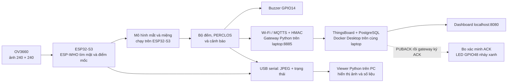

# Hệ thống hoạt động như thế nào?

Tài liệu này giải thích cách dự án giám sát tài xế hoạt động cho người mới.
Nếu mục tiêu của bạn là cài đặt và chạy ngay, hãy bắt đầu từ
[README gốc](../README.md). Sau khi chạy được stream, quay lại đây để hiểu
những con số và trạng thái đang thấy.

**Để đọc tới mức từng file và từng bước xử lý**, mở
[Giải thích mã nguồn theo từng file](GIAI_THICH_TUNG_FILE.md). Tài liệu đó
giải thích đầu vào/đầu ra, ai gọi các hàm, công thức model, bộ nhớ trạng
thái, cách các task phối hợp, từng script Python và ý nghĩa các lệnh
build/flash. Tài liệu này giúp nắm hành vi tổng thể trước khi theo code.

## 1. Toàn cảnh trong một phút

Bo **ESP32-S3-CAM N16R8** nhận ảnh từ camera **OV3660**. ESP-WHO tìm khuôn
mặt và các điểm trên mắt, mũi, miệng. Một mô hình nhỏ tiếp tục ước lượng
mắt đang nhắm và miệng đang mở. Firmware theo dõi các kết quả qua nhiều
khung hình để đếm blink, ngáp, tính PERCLOS và điều khiển buzzer.



**Nhận diện và quyết định cảnh báo diễn ra trên bo.** Viewer Python nhận kết
quả đã tính để hiển thị và có thể ghi video. ThingsBoard nhận số liệu JSON;
firmware này không gửi ảnh lên MQTT. Khi dùng nguồn USB riêng, bo vẫn tính
và báo tại chỗ. Gửi dữ liệu vào ThingsBoard local còn cần laptop, gateway,
container và đường LAN hoạt động; chỉ có Wi-Fi chưa đủ.

Gateway là chương trình `server.mqtt_guard.gateway` chạy nền bằng Python
trên Windows, **ngoài Docker**. ThingsBoard và PostgreSQL là hai container
trong nhóm `driver-monitor-local`. `VmmemWSL` bao gồm môi trường Linux của
Docker Desktop; không phải một bộ nhận diện mắt/miệng khác.

> “Nhận diện mặt” ở đây có nghĩa là tìm vị trí một khuôn mặt trong ảnh.
> Hệ thống chưa xác minh danh tính người lái.

## 2. Phần cứng đảm nhiệm việc gì?

| Thành phần | Việc nó làm |
| --- | --- |
| OV3660 | Chụp ảnh. Cấu hình hiện dùng ảnh RGB565 240 × 240, xung camera 20 MHz; firmware lật ảnh trái–phải như gương và sửa chiều dọc. |
| ESP32-S3 | Chạy ESP-WHO, mô hình mắt/miệng, bộ đếm, buzzer và MQTT. Không cần máy tính để tính kết quả. |
| Flash 16 MB | Lưu chương trình, model phát hiện mặt và các trọng số mắt/miệng sau khi nạp firmware. |
| PSRAM 8 MB | Có thêm bộ nhớ cho khung hình và xử lý ảnh. |
| USB serial | Đưa luồng JPEG và trạng thái đến PC, đồng thời là đường để nạp firmware. Bo này có thể dùng chip USB–UART CH343; Windows gán tên COM riêng như COM4 hoặc COM7. |
| Buzzer ở GPIO14 | Phát nhịp cảnh báo. Firmware hiện dành cho module buzzer chủ động, kích hoạt mức LOW. |
| LED RGB ở GPIO48 | Nháy xanh khoảng 150 ms sau ACK ứng dụng có HMAC từ gateway; ACK này được tạo sau PUBACK của ThingsBoard. |
| Wi-Fi 2,4 GHz | Đưa telemetry đã ký từ bo tới gateway; viewer COM vẫn dùng được khi Wi-Fi/MQTT lỗi. |

Nếu bo cùng tên N16R8 nhưng **chân camera khác ESP32-S3-EYE**, cần chỉnh
cấu hình chân trước khi nạp. GPIO4 đang là đường SDA của camera, nên buzzer
không được nối vào GPIO4.

## 3. Từ lúc cấp điện đến khung hình đầu tiên

1. Firmware khởi động ở [`app_main.cpp`](../examples/ov3660_face_detect/main/app_main.cpp).
   Nó đặt luồng serial ở 1500000 baud, thử buzzer bằng tiếng bíp ngắn, tắt
   LED cũ đang sáng và khởi tạo phần Wi-Fi/MQTT nếu đã có cấu hình.
2. [`frame_cap_pipeline.cpp`](../examples/ov3660_face_detect/main/frame_cap_pipeline.cpp)
   khởi động OV3660, đặt xung 20 MHz, lấy ảnh RGB565. Ảnh được lật trước
   khi đi vào các bước tiếp theo, vì vậy viewer và phần nhận diện nhìn cùng
   một hướng ảnh.
3. Task detect chép ảnh dưới mutex sang snapshot riêng, kiểm tra heuristic
   lỗi pha byte RGB565 rồi mới đưa ảnh hợp lệ vào model. Bộ lọc này giúp
   loại một kiểu lỗi ảnh nguồn; không phải cơ chế xác thực/chống giả mạo.
   ESP-WHO xử lý ảnh để trả về khung mặt và **5 điểm mốc**: hai mắt, mũi,
   hai khóe miệng. Mỗi ảnh mới gọi lại phần phân tích trong
   [`driver_behavior.cpp`](../examples/ov3660_face_detect/main/driver_behavior.cpp).
4. [`serial_jpeg_stream.cpp`](../examples/ov3660_face_detect/main/serial_jpeg_stream.cpp)
   đóng gói một ảnh JPEG có khung mặt và một bản trạng thái JSON gửi qua
   COM. Cùng lúc đó, trạng thái mới nhất được chuyển cho phần MQTT.

Một ảnh đơn lẻ chỉ cho biết **ước lượng tại thời điểm đó**. Bộ đếm blink,
ngáp và PERCLOS cần quan sát tiếp qua thời gian. Vì vậy vừa bật bo thì
`blink_count` có thể bằng 0 và PERCLOS chưa sẵn sàng dù viewer đã có ảnh.

## 4. Bo tìm mặt rồi đo mắt/miệng ra sao?

### 4.1. Tìm vị trí mặt

ESP-WHO trả về một hoặc nhiều mặt. Firmware chọn mặt có điểm phát hiện cao
nhất, lưu khung chữ nhật và 5 điểm mốc. Để đo mắt/miệng, khung mặt phải rộng
ít nhất khoảng **68 pixel** và cao ít nhất **75 pixel**. Nếu người ở quá xa,
bo có thể vẫn vẽ được mặt nhưng chưa đủ chi tiết để đo đáng tin cậy.

Khi há miệng rộng làm bộ tìm mặt bỏ sót ngắn hạn, firmware có thể giữ tọa độ
mặt gần nhất tối đa **1,2 giây** (`face_holdover=true`). Trong lúc giữ tọa
độ, firmware **không kết luận mắt mở hay nhắm** từ điểm mốc cũ. Viewer hiện
`Face: HELD 1.2s` trong bản classic/export để phân biệt với một mặt vừa tìm
được. Viewer tổng hợp hiện vùng Khuôn mặt/mắt; cờ chi tiết vẫn có trong JSON.

### 4.2. Mô hình mắt và miệng

Từ điểm mốc của từng mắt, bo lấy một vùng ảnh nhỏ **12 × 12 điểm sáng**.
Nó so độ sáng vùng đó với vùng da lân cận để giảm ảnh hưởng khi chuyển giữa
hai phòng có ánh sáng khác nhau. Mô hình mắt là mạng nhỏ có **24 nút ẩn**;
hai mắt dùng cùng bộ trọng số. Mỗi mắt trả về điểm gần 0–1 cho khả năng
“nhắm”, rồi bo lấy trung bình hai điểm. Mô hình miệng dùng vùng 12 × 12
quanh hai khóe miệng và một bộ phân loại tuyến tính để ước lượng khả năng
“mở”. Các trọng số nằm trong
[`driver_ml_weights.hpp`](../examples/ov3660_face_detect/main/driver_ml_weights.hpp).

Đây là **điểm số của mô hình**, không phải phép đo chắc chắn 100% trong mọi
điều kiện. Để giảm nhấp nháy giữa hai trạng thái, bo xem nhiều khung hình
liên tiếp trước khi đổi từ mở sang nhắm hoặc từ đóng sang mở:

| Quan sát | Cách quyết định hiện tại |
| --- | --- |
| Mắt gần nhìn thẳng | Điểm nhắm từ 0,80 có thể bắt một khung rất ngắn; mức 0,50 cần hai khung liên tiếp. Mở lại cần hai khung dưới 0,50. |
| Đầu nghiêng nhẹ | Cần hai khung liên tiếp có điểm nhắm ít nhất 0,65. |
| Đầu nghiêng quá mức | Nếu mũi lệch so với trung điểm hai mắt quá 18% khoảng cách hai mắt, `eyes_valid=false`; bo tạm ngừng đếm blink/PERCLOS từ các khung đó. |
| Miệng | Hai khung liên tiếp có điểm mở từ 0,50 để chuyển sang “mở”; hai khung dưới 0,50 để chuyển lại “đóng”. |

Ngoài góc đầu, ảnh quá tối, không thấy đủ điểm mốc hoặc thiếu mặt cũng có
thể làm `eyes_valid=false` hay `mouth_valid=false`. **“Không hợp lệ” không có
nghĩa là “mở” hoặc “đóng”.** Viewer tổng hợp hiện KHÔNG RÕ (classic hiện
`Eyes: UNKNOWN`); telemetry MQTT gửi
`eyes_closed: null` và `eye_closed_probability: null` khi mắt không hợp lệ.
Nếu camera cứ hướng lên trần, `driver_present=false` và không có số đo mắt.

`scene_luma` và `face_luma` là độ sáng trung bình của ảnh, thang **0–255**.
Chúng giúp nhận biết cảnh tối/ngược sáng; chúng **không phải đơn vị lux**.
Ngoài chuẩn hóa theo da, `driver_lighting.cpp` điều chỉnh mục tiêu phơi
sáng của OV3660 theo độ sáng mặt: tăng/giảm từng mức, làm mượt tín hiệu và
chờ ít nhất 1,5 giây giữa hai lần đổi. Sau ba giây không có mặt, dùng độ
sáng toàn cảnh. Viewer có `Light`, `AE` để theo dõi. Đây là bù ảnh từ cảm
biến, không tự train model mới. Cần thử thật ở từng phòng để biết model
có còn nhận đúng hay không; không thể khôi phục chi tiết khi quá tối/cháy sáng.

## 5. Blink và ngáp được đếm thế nào?

### Blink

Bo ghi thời điểm mắt chuyển sang nhắm. Khi mắt **mở lại**, một blink được
đếm nếu lần nhắm kéo dài từ **80 ms đến 1,2 giây**. Nhắm mắt 4 giây là một
trạng thái nhắm lâu, **không phải bốn lần blink**. Nếu đầu quay quá nghiêng
và mắt không còn hợp lệ, trạng thái nhắm cũ bị bỏ để tránh cộng blink giả
khi quay về. `blink_count` là tổng từ lần khởi động hiện tại;
`blink_window_count` đếm những blink còn nằm trong cửa sổ gần 60 giây.
Tần suất blink hiện **không tự kích hoạt buzzer**.

### Ngáp

Bo chỉ tính một lần ngáp khi `mouth_open=true` liên tục ít nhất **0,8 giây**.
Sau khi tính, miệng cần đóng khoảng **1 giây** mới có thể ghi lượt ngáp tiếp.
Vì vậy giữ miệng há 5 giây không tăng `yawn_count` thêm 5 lần.
`yawn_count` là tổng từ lúc khởi động; `yawn_window_count` là số lượt còn
trong 60 giây gần nhất để xét cảnh báo. Hai bộ đếm có mục đích khác nhau.

Ví dụ: bạn ngáp ở giây 5, 25 và 40 thì `yawn_window_count=3` ở giây 40.
Bo báo ngáp trong **10 giây**. Sau khi lượt báo kết thúc, cửa sổ ngáp được
xóa và cần **ba lần ngáp mới** để báo tiếp; `yawn_count` vẫn giữ tổng 3.

## 6. PERCLOS là gì, vì sao có lúc chưa báo?

PERCLOS là **tỷ lệ thời gian mắt được xác định là nhắm trên tổng thời gian
bo quan sát mắt hợp lệ** trong cửa sổ gần **60 giây**:

```text
PERCLOS = thời gian mắt nhắm hợp lệ / thời gian quan sát mắt hợp lệ
```

Ví dụ trong 60 giây vừa qua, camera thấy rõ mắt trong **40 giây**, trong đó
mắt được kết luận nhắm **7 giây**. PERCLOS = 7 / 40 = **17,5%**, vượt mức
cảnh báo mặc định 15%. Nếu 20 giây còn lại bị mất mặt/đầu quay nghiêng,
chúng không được cộng vào mẫu số như thời gian “mắt mở”.

Bo bắt đầu hiển thị một ước lượng PERCLOS khi đã có ít nhất **2 giây** quan
sát hợp lệ. Tuy nhiên cảnh báo chỉ được xét khi **đã qua 60 giây từ mẫu mắt
hợp lệ đầu tiên** và trong cửa sổ có ít nhất **30 giây** mắt hợp lệ. Viewer
hiện `COLLECT` khi chưa đủ điều kiện và `READY` khi đã đủ. Do đó PERCLOS
17,5% ở giây thứ 20 vẫn chưa tạo cảnh báo.

Khi cảnh báo PERCLOS bắt đầu, buzzer phát nhịp ba tiếng trong tối đa
**15 giây**. Kết thúc lượt này, firmware xóa lịch sử PERCLOS và thu thập
cửa sổ mới. Tổng blink/ngáp không bị xóa vì hai bộ đếm đó độc lập. Giá trị
MQTT `perclos` là tỷ lệ **0–1**: 15% được gửi là `0.15`.

## 7. Buzzer và LED phản ứng ra sao?

Ngưỡng mặc định được khai báo trong
[`Kconfig.projbuild`](../examples/ov3660_face_detect/main/Kconfig.projbuild)
và có thể đổi qua `idf.py menuconfig` → **Driver monitor buzzer**.

| Điều kiện | Nhịp buzzer hiện tại | Khi nào dừng hoặc xóa |
| --- | --- | --- |
| Nhắm mắt liên tục ≥ 1,5 giây | Một tiếng theo chu kỳ 0,5 giây | Dừng khi mắt mở lại hoặc không còn đủ dữ liệu hợp lệ. |
| Ngáp ≥ 3 lần trong 60 giây | Hai tiếng ngắn lặp mỗi 2 giây, tối đa 10 giây | Xóa cửa sổ ngáp sau lượt báo, tổng ngáp giữ nguyên. |
| PERCLOS ≥ 15%, đủ cửa sổ | Ba tiếng ngắn lặp mỗi 2 giây, tối đa 15 giây | Xóa lịch sử PERCLOS sau lượt báo. |
| Không thấy mặt liên tục ≥ 5 giây | Một tiếng ngắn mỗi 3 giây | Dừng khi bo tìm lại mặt. |

Nếu nhiều điều kiện cùng xảy ra, phần chọn **âm buzzer** ưu tiên nhắm mắt
lâu, sau đó điều kiện không thấy mặt nếu mặt vắng, rồi PERCLOS, rồi ngáp.
`alert_reasons_mask` vẫn cho biết các lý do đang có: bit **1** = nhắm mắt
lâu, **4** = ngáp nhiều, **8** = PERCLOS cao, **16** = không thấy mặt. Ví dụ
`12 = 4 + 8` là ngáp nhiều và PERCLOS cao cùng lúc. Trên ThingsBoard,
`alert_reasons` là dòng chữ tiếng Việt để người quản trị đọc dễ hơn.

LED GPIO48 có mục đích khác buzzer: bo chỉ nháy khi xác minh được ACK ứng
dụng của gateway, sau khi ThingsBoard PUBACK. `mqtt_acked` của broker đầu
vào chưa đủ để bật LED ở chế độ guard. ACK/PUBACK chưa khẳng định database
đã commit hay model nhận đúng; cần REST/UI và timestamp mới để đối chiếu lưu.

## 8. Hai đường truyền dữ liệu: COM và MQTT

### COM: ảnh và chẩn đoán trực quan

Khung mới nhất được bo chép sang bộ đệm riêng; một task stream vẽ khung mặt,
nén bằng `esp_new_jpeg` rồi gửi. Queue chỉ giữ một preview đang chờ, nên có
thể bỏ preview cũ để giữ độ mới mà phần nhận diện vẫn tiếp tục chạy. Video gửi
cùng một JSON trạng thái qua **UART 1500000 baud**. Gói có dấu bắt đầu,
loại gói, độ dài và mã kiểm tra. [`driver_monitor_viewer.py`](../examples/ov3660_face_detect/driver_monitor_viewer.py)
trên PC tìm gói, kiểm tra dữ liệu, giải mã JPEG và vẽ bảng kết quả. Nếu
gói hỏng, viewer bỏ gói và tìm gói tiếp theo; `Bad UART` giúp bạn thấy số
gói hỏng trong classic; viewer tổng hợp ghi UART lỗi. Chỉ **một chương trình**
có thể mở cùng cổng COM tại một thời điểm.

`Face`, `Eyes`, `Mouth`, `PERCLOS`, `Blinks`, `Yawns`, `WiFi`, `Time`, `Guard`, `TB seq`
là nhãn trong classic; viewer tổng hợp dùng các mục tiếng Việt tương ứng ở
vùng ESP32. Các giá trị đó đều lấy từ trạng thái bo gửi. PC không tính lại blink/ngáp từ
ảnh. Khi nhấn RST, bo khởi động lại; viewer có thể hiện chờ vài giây rồi
nhận luồng mới. Nếu COM bị chiếm, đóng viewer trước khi nạp firmware.

Viewer tổng hợp còn đọc metadata health/audit của gateway trên laptop và
REST của ThingsBoard, cạnh vùng camera/ESP32. Đây là ba nguồn độc lập:
serial nhận được không chứng minh Wi-Fi/MQTT nối; gateway sống không chứng
minh bo gửi; API trả mẫu cũ không chứng minh đang có telemetry mới. Giao
diện phân biệt và đánh dấu dữ liệu cũ. Tab sự kiện ESP32 được suy ra từ JSON,
không phải thu toàn bộ console ESP-IDF thô trên UART nhị phân.

### MQTT: số liệu qua gateway tới ThingsBoard local

Bo dùng SSID/password đã cấu hình, nhận IP rồi lấy giờ từ NTP trên laptop
(UDP 123). Sau lần đồng bộ đầu tiên, bo mở TLS tới `mqtts://IP_PC:8885`, kiểm
tra CA, IP/hostname và thời hạn chứng chỉ. Mật khẩu MQTT và HMAC key là hai
lớp khác nhau. Client ID/topic ACL giới hạn đường gửi và nhận của mỗi bo.

Bo subscribe `dm/v1/<device_id>/down`, gửi hello có HMAC và nhận session có
hạn từ gateway. Mẫu mỗi khoảng 5 giây được bọc cùng boot nonce, session ID,
sequence, timestamp và tuổi mẫu rồi ký. Gateway kiểm tra trước khi ghi outbox
SQLite và chuyển mẫu hợp lệ sang ThingsBoard qua `127.0.0.1:18884`.
Token đích chỉ nằm ở gateway; bo không dùng token ThingsBoard để gửi thẳng.

`sequence` tăng ở mỗi chu kỳ đã có mẫu, kể cả lúc offline; khoảng nhảy không
tự là tấn công. Mẫu quá cũ bị loại, không có nhật ký lưu mọi phép đo offline
trên flash. `mqtt_acked` đếm PUBACK của gateway đầu vào. Chỉ sau PUBACK của
ThingsBoard, gateway mới ký ACK để bo tăng `guard_forwarded_sequence`/
`guard_forwarded_count` và nháy LED. Kiểm thử REST đọc lại database riêng,
vì MQTT PUBACK không tương đương commit lưu trữ.

Trong dữ liệu hành vi, `boot_id` là số 32 bit để đọc lần chạy; boot nonce
128 bit của phong bì xác thực là trường riêng. Chống replay trên gateway
còn dựa vào `auth_device_id`, `auth_session_id`, `auth_sequence` và SQLite.
Không dùng riêng cặp boot_id số/sequence để thay cơ chế xác thực này.

Giờ lấy từ PC chưa có xác thực NTP riêng. Chờ mạng/giờ/TLS không chặn camera
và buzzer. Khi `eyes_valid`, `mouth_valid` hoặc `perclos_valid` không đạt,
trường trạng thái/số đo tương ứng trên MQTT là `null`, không giả thành mở/0.
Xem [cơ chế chi tiết](KE_HOACH_CHONG_GIA_MAO.md) và [local A–Z](CHAY_LOCAL_A_Z.md).

### Đọc các trường thường gặp

| Trường | Hiểu đơn giản |
| --- | --- |
| `driver_present` | Bo vừa tìm được mặt, hoặc còn đang giữ tọa độ mặt trong khoảng bỏ sót ngắn. Xem thêm `face_holdover` để phân biệt. |
| `eyes_valid`, `mouth_valid` | Bo có đủ dữ liệu để kết luận mắt/miệng trong khung hiện tại. Nếu là `false`, đừng diễn giải trạng thái cũ thành trạng thái hiện tại. |
| `eyes_closed`, `mouth_open` | Kết luận sau khi đã lọc qua nhiều khung hình. Trên MQTT chúng có thể là `null` khi dữ liệu không hợp lệ. |
| `eye_closed_probability`, `mouth_open_probability` | Điểm số 0–1 của mô hình trước bước quyết định trạng thái; điểm cao hơn nghĩa là mô hình nghiêng về nhắm mắt hoặc mở miệng hơn. |
| `blink_count`, `yawn_count` | Tổng số lần được đếm từ lúc bo khởi động, không tự xóa sau một lượt cảnh báo. |
| `blink_window_count`, `yawn_window_count` | Số lần còn trong cửa sổ gần 60 giây; cửa sổ ngáp còn được xóa sau lượt báo ngáp. |
| `eye_closed_duration` | Số giây mắt đang nhắm liên tục trong lần hiện tại; về 0 khi mở mắt hoặc mất phép đo. |
| `auto_light`, `ae_level`, `lighting_state` | Camera có nhận control bù sáng hay không, mức mục tiêu AE và trạng thái sáng (`ADJUST`, `OK`, `DARK`, `BRIGHT`; serial dùng mã 0..4). |
| `perclos`, `perclos_observed_s`, `perclos_window_ready` | Tỷ lệ nhắm mắt, số giây mắt hợp lệ đã quan sát, và cờ cho biết đã đủ dữ liệu để xét cảnh báo. |
| `alert_reasons`, `alert_reasons_mask`, `buzzer_pattern` | Lý do cảnh báo dạng chữ, dạng bit để máy xử lý, và kiểu nhịp buzzer đang được chọn. |
| `boot_id`, `sequence` | Mã lần khởi động dạng số trong dữ liệu và số thứ tự chu kỳ gửi; khác boot nonce/session dùng xác thực. |
| `auth_device_id`, `auth_session_id`, `auth_sequence` | Gateway tạo sau xác minh; dùng nhận ra nguồn/phiên/thứ tự đã được chấp nhận. |

## 9. Huấn luyện model rồi đưa lên bo

Một lượt ghi từ [`record_training_video.py`](../examples/ov3660_face_detect/record_training_video.py)
tạo `training_video.avi`, các ảnh JPEG nguyên gốc trong `frames/` và
`frames.jsonl` chứa thời gian cùng tọa độ mặt. Người xem video tạo
`labels.json`: đánh dấu những đoạn **chắc chắn** mắt mở/nhắm và miệng
đóng/mở. Dự đoán cũ của bo không được dùng làm nhãn đúng.

Repo giữ **model đã học**, còn ảnh/video và nhãn huấn luyện cũ đã được bỏ.
Các mảng trọng số và tham số chuẩn hóa trong `driver_ml_weights.hpp` là kết
quả của quá trình học: firmware dùng chúng để tính điểm mắt/miệng trên ảnh
mới. Khi build, các mảng này được biên dịch vào chương trình và khi flash
chúng nằm trên bo. Bo không cần mở lại video đã dùng để train.

Nếu muốn train lại, trước tiên ghi một phiên mới và gắn nhãn như trên.
[`train_driver_model.py`](../examples/ov3660_face_detect/train_driver_model.py)
đọc nhãn và ảnh, lấy cùng kiểu vùng 12 × 12 điểm như firmware, chia dữ liệu
train và kiểm tra theo mốc `validation_from_second`. Script huấn luyện hai mô hình
trên PC, in số mẫu cùng ma trận lỗi `[[TN, FP], [FN, TP]]`, rồi viết
`driver_ml_weights.candidate.hpp`.

File `candidate.hpp` **chưa chạy trên bo**. Sau khi xem kết quả, bạn sao
lưu `driver_ml_weights.hpp`, chép ứng viên vào tên đó, về gốc repo và chạy
`tools/Build-Flash.ps1 -Port COM4`. Lúc ấy trọng số mới mới nằm trong firmware trên
ESP32-S3. Xem [mục 8 của README gốc](../README.md)
để có từng lệnh PowerShell và cách quay lại model cũ.

Một số chỉ số kiểm tra tốt trên video gắn nhãn vẫn có thể không đúng ở
người khác, khi đầu quay khác góc hoặc ánh sáng khác. Hãy thử model trên
stream thật trước khi thay bản đang dùng. Các phiên ghi mới được lưu cục bộ
trong `recordings/` và bị Git bỏ qua.

## 10. Tìm phần mình muốn sửa trong mã nguồn

Bảng dưới đây là mục lục nhanh. Phần giải thích đầy đủ nằm ở
[từng file firmware](GIAI_THICH_TUNG_FILE.md#firmware),
[từng script PC](GIAI_THICH_TUNG_FILE.md#python),
[các file cấu hình/build](GIAI_THICH_TUNG_FILE.md#cau-hinh) và
[thư viện ESP-WHO](GIAI_THICH_TUNG_FILE.md#thu-vien).
Sau đó xem [các ví dụ theo dấu lời gọi hàm](GIAI_THICH_TUNG_FILE.md#theo-dau)
để hiểu vì sao một thao tác chớp mắt lại làm thay đổi count, buzzer và MQTT.

| Muốn hiểu hoặc đổi | File nên mở trước |
| --- | --- |
| Khởi động và luồng xử lý chính | [`app_main.cpp`](../examples/ov3660_face_detect/main/app_main.cpp) |
| Camera, kích thước ảnh, lật gương | [`frame_cap_pipeline.cpp`](../examples/ov3660_face_detect/main/frame_cap_pipeline.cpp) |
| Mô hình và quy tắc mắt/miệng, blink, PERCLOS | [`driver_behavior.cpp`](../examples/ov3660_face_detect/main/driver_behavior.cpp) |
| Các trọng số mô hình mắt/miệng trong firmware | [`driver_ml_weights.hpp`](../examples/ov3660_face_detect/main/driver_ml_weights.hpp) |
| Ngưỡng cảnh báo, cửa sổ ngáp, buzzer | [`driver_alert.cpp`](../examples/ov3660_face_detect/main/driver_alert.cpp), [`Kconfig.projbuild`](../examples/ov3660_face_detect/main/Kconfig.projbuild) |
| JSON + JPEG qua COM | [`serial_jpeg_stream.cpp`](../examples/ov3660_face_detect/main/serial_jpeg_stream.cpp) |
| Bù phơi sáng theo môi trường/mặt | [`driver_lighting.cpp`](../examples/ov3660_face_detect/main/driver_lighting.cpp) |
| Wi-Fi, MQTT, `sequence`, ACK | [`driver_telemetry.cpp`](../examples/ov3660_face_detect/main/driver_telemetry.cpp) |
| Ký HMAC, session và ACK của local guard | [`driver_message_auth.cpp`](../examples/ov3660_face_detect/main/driver_message_auth.cpp), [`server/mqtt_guard/verifier.py`](../server/mqtt_guard/verifier.py) |
| LED GPIO48 | [`driver_status_led.cpp`](../examples/ov3660_face_detect/main/driver_status_led.cpp) |
| Cửa sổ stream trên PC | [`driver_monitor_viewer.py`](../examples/ov3660_face_detect/driver_monitor_viewer.py) |
| Bảng ESP32/gateway/ThingsBoard trong cùng cửa sổ | [`driver_system_monitor.py`](../examples/ov3660_face_detect/driver_system_monitor.py) |
| Ghi video và huấn luyện | [`record_training_video.py`](../examples/ov3660_face_detect/record_training_video.py), [`train_driver_model.py`](../examples/ov3660_face_detect/train_driver_model.py) |

## 11. Ví dụ một lượt hoạt động

Bạn cắm nguồn. Bo chụp ảnh, tìm thấy mặt nên `driver_present=true`. Hai
mắt rõ, nhìn gần thẳng nên `eyes_valid=true`. Sau vài khung liên tiếp, mắt
được đánh giá “mở”. Khi bạn nhắm mắt khoảng 0,3 giây rồi mở, bo tăng
`blink_count` lên 1. Nếu bạn nhắm liên tục 2 giây, bo không cộng một loạt
blink; sau 1,5 giây buzzer báo nhắm mắt lâu. Khi mắt mở, báo này dừng.

Bo vẫn tiếp tục ghi thời gian mắt hợp lệ. Sau ít nhất một phút và đủ 30
giây quan sát, PERCLOS được phép gây cảnh báo nếu tỷ lệ nhắm đạt 15%.
Khoảng 5 giây một lần, bo gửi **số liệu hiện tại** lên ThingsBoard, nhận
ACK ứng dụng có HMAC sau PUBACK ThingsBoard thì LED nháy xanh. Viewer trên PC vẫn nhận ảnh và trạng thái qua COM
liên tục; đóng viewer không làm bo ngừng nhận diện hoặc gửi MQTT.

## 12. Phạm vi bảo mật và bài kiểm thử đang có

Trong cấu hình này, gateway nhận MQTTS 8885 và NTP UDP 123 từ các interface
PC được firewall cho phép. Web 8080/MQTT18884 publish localhost, PostgreSQL
chỉ dùng mạng nội bộ Docker. IP LAN không đồng nghĩa địa chỉ public Internet;
khả năng truy cập từ ngoài còn phụ thuộc router, firewall, VPN hoặc tunnel.
ESP32 là client; laptop/Windows, Wi-Fi, tài khoản ThingsBoard, khóa phần mềm
và cổng nạp vật lý cũng thuộc các thành phần cần bảo vệ.

Kiểm thử tự động tạo gói từ **client Python mô phỏng bên gửi** để kiểm tra
bộ nhận/xác minh của gateway, đối chiếu thêm kết quả lưu trên ThingsBoard.
Không gọi đó là tấn công đã chiếm quyền ESP32 hoặc tấn công dashboard.
Bo thật đã được kiểm tra vận hành kết nối/ký/gửi/ACK song song; đó là bằng
chứng tích hợp, khác với thử khai thác firmware ESP32.

- `Test-LiveSecurity.ps1`: gửi vào gateway thật 8885, làm bộ đếm dashboard
  thật tăng. Danh tính tạm demo_only cách ly mẫu chuẩn khỏi hàng đợi gửi.
- `Test-Security.ps1 -Demo`: bộ hồi quy riêng 8886/device thử; không cộng
  counter vào dashboard thật. Kiểm tra thêm dữ liệu được lưu bằng REST.
- Unit test dùng clock mô phỏng cho reset/restart/expiry/schema. Không
  tương đương thử mất điện vật lý, kiểm thử Wi-Fi/OS, DoS hoặc pentest web.

VERIFIED là đạt kiểm tra thông điệp, không chứng minh người thật, đúng danh
tính hoặc chính xác thị giác. Khóa bị lộ/firmware bị chiếm quyền hoặc token
đích bị lấy vẫn nằm ngoài bảo vệ hiện tại. Xem [kịch bản demo](DEMO_BAO_MAT_VA_KIEM_THU.md).

Ba bài thử riêng vẫn có ý nghĩa: máy không có quyền MQTT bị từ chối đăng
nhập; client đã đăng nhập nhưng sai HMAC bị chặn nội dung; gói có HMAC đúng
vẫn bị bỏ qua/từ chối nếu trùng sequence hoặc sai phiên. Lớp cuối bảo vệ
khỏi phát lại và ghi lặp: gói đó không tạo thêm mẫu telemetry, audit vẫn
ghi nhận lý do. Đây không phải chỉ ẩn số liệu trong dashboard.

Mật khẩu và khóa HMAC hiện cùng nằm trong sdkconfig và config gateway.
Chúng khác chức năng nhưng chưa được cách ly nơi lưu. Nếu mất cả hai,
người giả mạo có thể xin phiên mới và ký dữ liệu giả với sequence mới;
chống phát lại không chứng minh phép đo đến từ camera thật. Giả định chỉ
lộ mật khẩu là một tình huống thử lộ một phần, không phải bảo đảm khi đã
đọc được toàn bộ cấu hình/firmware. CA công khai không phải một trong hai
bí mật đó; nhiều client có thể cùng dùng nó để xác minh gateway.
